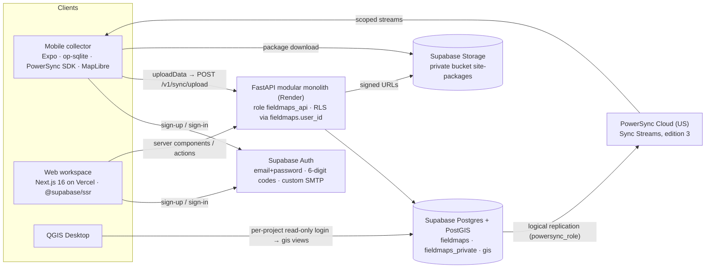

# Architecture: target system, layering, security rules

This file is part of the [DECA Mark production plan](README.md) and defines no tasks. It describes the shape that every task builds toward. When a task and this file disagree, stop and ask; do not quietly pick one.

## Current implementation boundary (reconciled 2026-10-15)

Web uses Supabase SSR identity and real FastAPI data, SVG zone editing and immutable package history. FastAPI serves one `/v1` contract, including bound observations, conditional draft publication, paging, summaries and ZIP exports. The canonical schema is the fresh baseline plus subsequent migrations, not the retired incremental ledger. Hosted reconciliation is separately gated by the dated [diagnosis](../reviews/ci-and-hosted-data-2026-10-14.md).

Mobile uses SQLite, MapLibre, the current outbox and verified package storage. It has retained sessions, boundary-aware screens and MOB-29’s immutable bound foreground uploads with exact receipts, structured rejections and reconnect/resume/retry. Disposable loopback API/SQLite acceptance passes actual install/save/restart, newer publication, replay, conflicting-body 409 and point/Inventory export, and native QGIS demo/live-export readback passes; physical iPad/Android collector acceptance remains pending ([evidence](../reviews/mob29-2026-10-15/README.md)). PowerSync/op-sqlite and Storage-backed package delivery below are target architecture, not the installed transport. GIS-09 implements recorded-zone SQL/export semantics; native QGIS demo/live-export readback is locally verified, while general typed views and scoped live grants remain separate.

Use [current position](current-state.md) and owner plans for evidence and next tasks. The target diagram does not establish deployment or device acceptance.

## Target system (PowerSync/Storage lane remains gated)

## Security rules

1. **Every write goes through FastAPI.** Neither client writes to Postgres or Storage directly, except for uploading to a Storage URL the API has signed.
2. **The Data API stays closed for DECA Mark schemas.**
   - `fieldmaps`, `fieldmaps_private`, `fieldmaps_auth_hooks` and `gis` are never exposed or granted to `anon`, `authenticated` or `service_role`.
   - DB-04 adds the **global** default-privilege revoke for functions (a per-schema revoke is a no-op; verified), plus a coverage test.
3. **There are three read paths, each with its own boundary:**
   - **Web** reads go through FastAPI, where RLS on `fieldmaps_api` applies.
   - **Mobile target** reads go through PowerSync after SYNC-01/02; the current collector reads the API and verified installed packages on the D27 outbox path. PowerSync replicates with `BYPASSRLS`, so the **stream definitions are the security boundary**. SYNC-02 will define them in the repository and QA-02 will verify isolation; neither is completed.
   - **QGIS** reads `gis` views as a member of `fieldmaps_gis_reader`. The boundary is three things together:
     - RLS policies `TO fieldmaps_gis_reader`, keyed on active, non-training grants;
     - column-limited SELECT;
     - no USAGE on `fieldmaps`, so raw tables cannot be named (GIS-01).
4. **Role checks name the caller.**
   - Every membership test, in a policy or an API query, filters on `fieldmaps.request_user_id()` or goes through a `fieldmaps_private` helper (BE-16, DB-05).
   - Never rely on the memberships SELECT policy to hide other members' rows. Once managers may read their project's memberships, a check like `EXISTS (… m.role = 'manager')` would pass for anyone on the project (reproduced).
   - The API also asserts at startup that its role cannot bypass RLS (`NOT rolbypassrls`, BE-02).
5. **SECURITY DEFINER functions:**
   - They live only in `fieldmaps_private`.
   - Each has `search_path = ''`.
   - `EXECUTE` is granted only to `fieldmaps_api`, or to nobody when another definer function calls it (`publish_gis_view`).
   - **Read helpers** used in RLS (`my_project_ids()`, `has_project_role()` …) return no rows or `false` when `fieldmaps.request_user_id()` is NULL. They never raise.
   - **Functions that change data** raise when there is no identity. Each authorizes the caller against the rows it touches: a non-null identity alone is not authorization.
   - Nothing uses SECURITY DEFINER just to get past a permission error.
   - **The audit trigger is the one deliberate exception.** `fieldmaps_private.audit_row()` and `audit_export()` (DB-13) are SECURITY DEFINER, with EXECUTE revoked from everyone. Triggers run as the statement's user, and `fieldmaps_api` must never hold INSERT on `audit_events`, or it could forge audit rows.
   - **Function parameters are prefixed** (`p_project_id` …). In SQL functions a column shadows a same-named parameter; this was verified to turn a manager check into "manager of any project".
   - **Auth hooks are also an exception.** They are SECURITY INVOKER in `fieldmaps_auth_hooks`, with `EXECUTE` only for `supabase_auth_admin`. They make no `request_user_id()` check, because none is set during sign-up, and they return `'{}'::jsonb` on success (DB-08).
6. **No authorization data in `user_metadata`.** Users can edit it. Authorization data never comes from JWT claims beyond `sub`, `iss`, `aud` and `exp`. Tokens with `is_anonymous` are rejected (BE-05).
7. **Files never go into synced rows.**
   - Package archives move from `bytea` to Storage (DB-12, BE-13), because PowerSync caps a row at 15 MB and archives can reach 16 MiB.
   - Rows carry metadata and the sha256.
8. **Secrets are injected at runtime only.** This covers the Render Secret Files and the Supabase secret key used for account deletion (BE-08). The publishable key and URLs are public config.

## Environments

| Environment | Supabase | PowerSync | API | Web | Mobile |
|---|---|---|---|---|---|
| local | `supabase start` (Mailpit, `auth` schema, PostGIS) from DB-02 | none: sync flows are tested against staging (MOB-21) | `uv run` or Docker against local Supabase | `pnpm dev` | dev build with `APP_ENV=development` (`com.fieldmaps.collector.local`) |
| staging | the current project `lezmqhuucfwqknspgcdy` | Cloud Free (OPS-08) | Render staging (OPS-04) | Vercel preview | EAS `preview` (`com.fieldmaps.collector.dev`, D15) |
| production | a new project, Pro (OPS-09) | Cloud Pro | Render production | Vercel production | EAS `production` |

Each environment gets its own PowerSync instance and replication slot. Never point two PowerSync instances at one Supabase project; slots are limited (see [sync-powersync.md](sync-powersync.md#source-database)).

## Layering inside each component

| Component | Layers, top to bottom | Rule |
|---|---|---|
| Mobile (`mobile/`) | `app/` routes (thin) → `src/features/*` (screens, hooks) → `src/domain` (form engine, record builder; pure) → `src/data` (PowerSync schema and queries, API client, file store) → `src/platform` (auth storage, NetInfo, location) | UI never runs SQL directly; `src/domain` has no I/O and keeps its unit tests |
| Web (`web/`) | `src/app/` route groups → `src/features/*` → `src/lib/api` (generated types plus a server-only fetch wrapper) → `src/lib/supabase` (SSR clients) | Tenant data is fetched on the server; client components receive props or call Server Actions |
| API (`backend/`) | `routers/<module>.py` → `services/<module>.py` → `repositories/<module>.py` (SQL constants in `queries`) → the database | Services raise domain errors; one handler maps them to the error envelope ([contracts.md](contracts.md#error-envelope)); repositories never raise `HTTPException` |
| Database (`supabase/`) | `fieldmaps` (tables with RLS) · `fieldmaps_private` (SECURITY DEFINER helpers) · `gis` (generated read views) · `fieldmaps_meta` (ledger) | Every table has RLS enabled; `supabase/migrations/` is the only migration source after DB-02/DB-03 |

## API modules (modular monolith)

| Module | Owns | Tasks |
|---|---|---|
| `identity` | me, profile, account deletion | BE-06, BE-08 |
| `tenancy` | organizations, projects, members, invitations | BE-07 |
| `sites` | sites, zones, packages, Storage | BE-13 |
| `instrument` | forms, versions, publish, retire | BE-10, BE-11 |
| `collection` | current bound PUT/receipts; future sync batches and rejections | BE-22, BE-12 |
| `analysis` | observation queries, summary, exports | BE-14 |
| `gis` | reader grants (pilot); OGC API Features later | BE-15, GIS-06 |

## Fixture and practice-data inventory (current boundaries)

Fixtures remain only in test tooling and clearly separate mobile practice data. They must not pass for real observations or a live manager workspace. The following owners retain the actual pilot cleanup scope:

| Surface | Current boundary | Owner |
| --- | --- | --- |
| Web | D30 removed workspace fixtures, preview bypass and sample-only actions. Local E2E synthetic seeds remain intentional test infrastructure. | WEB-27 |
| Mobile account/projects | Public build profiles and caller-scoped project/profile cache exist; native identity/join and stale UI cleanup remain. | MOB-01/04, MOB-03/05/06/27 |
| Mobile maps/forms | Joined sites download exact verified archives/forms; bundled practice remains separate. Removing production practice fixtures and establishing server Training delivery remain pilot work. | MOB-13/14/15 |
| Mobile observations | Exact bindings, retention and immutable foreground upload/receipt/rejection are implemented; disposable HTTP/SQLite acceptance is recorded under MOB-29, native QGIS readback also passes, while physical iPad/Android collector acceptance remains pending. Bundled practice stays local-only. Later PowerSync transition preserves the supported schema without experimental legacy bridges. | MOB-29, MOB-09/10/11 |
| GIS | Recorded-zone views exist; generic per-form live reader surfaces and scoped provisioning remain distinct. | GIS-09, GIS-01/02/03 |

## What is deliberately not in the architecture yet

- General GIS processing workers remain future GIS-07 scope. The API already has a bounded transactional-email delivery worker; that does not implement the GIS queue.
- Multi-region hosting.
- Billing.
- Closed-app background sync.
- Photo attachments.
- A visual form builder.

Each is post-pilot; see the backlog in the [README](README.md#cut-list-if-the-schedule-slips).
