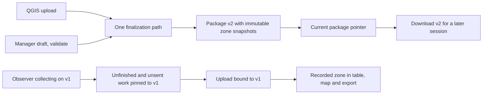

# Zone polygon boundaries: master implementation plan

Planning baseline: 2026-10-10, rewritten 2026-10-11 to the owner's [pre-launch compatibility policy](../README.md#pre-launch-compatibility-policy-2026-10-11). There are no real users. Data is reset whenever the schema changes, and this feature keeps nothing for old data, old clients, old formats or an older API version. Implementation is authorized in dependency order; source changes and disposable local tests are allowed. Commits, hosted resets, deployments and releases remain separately authorized. Task status does not claim shipped functionality. Finish this feature and its acceptance gates before starting other map features.

## Outcome and scope

- **Managers:** a manager draws and edits named polygon zones for a site, validates them and publishes them as a new immutable map version. A site's first version comes from a QGIS upload (`v1`); every later upload or publication adds one.
- **Observers:** an observer downloads a version, collects offline against those exact boundaries, and uploads later even if a newer version has been published.
- **Review:** managers filter maps, tables and exports by the zone and version each observation was recorded with, and nothing is reclassified against today's boundaries.

The first delivery edits zones over a site's uploaded ground and reference layers. It does not add imagery ingestion, basemap configuration, round scheduling, new form types, observation correction, live collaboration or a new sync engine. A site without a usable ground boundary needs a QGIS upload first.

## Read order and ownership

| Document | Authority |
| --- | --- |
| This master plan | Product invariants, decisions, scope, coordination and release order |
| [Contract](contract.md) | Wire shapes, errors, geometry semantics and the single-path rules |
| [Current architecture assessment](assessment.md) | Source-backed baseline from 2026-10-10 (historical; describes the code before this feature) |
| [Database plan](../../../supabase/ZONE-BOUNDARIES.md) | Storage, constraints, RLS, publication transaction |
| [Backend plan](../../../backend/ZONE-BOUNDARIES.md) | Services, routes, validation and queries |
| [Mobile data plan](../../../mobile/ZONE-BOUNDARIES.md) | Offline persistence, package and session ownership, upload |
| [Mobile UI plan](../../../mobile/ZONE-BOUNDARIES-UI.md) | Observer screens and the read models they need |
| [Web handoff](../../../web/ZONE-BOUNDARIES.md) and [web UI plan](../../../web/ZONE-BOUNDARIES-UI.md) | Manager editor, review, state architecture |
| [GIS plan](../../../qgis/ZONE-BOUNDARIES.md) | Recorded geometry, typed exports and read-only analysis |
| [Verification and edge cases](verification.md) | Release-blocking scenarios and evidence requirements |

Task status lives only in the owning `PLAN.md` files and the contract and verification task files. These documents hold specifications, not progress. The [production index](../README.md) links the tasks into its dependency graph.

## Non-negotiable behavior

1. **Versions are immutable.** An observation references one published package and a zone in it. Changing a boundary or label creates a new package; earlier geometry, labels, observations and receipts never change.
2. **Offline work survives.** Publication never swaps the map under an observer who is collecting. An unfinished observation and every unsent record keep their package. An expired login pauses uploads, not local preservation. Revoked access does not authorize upload or erase device data. A deliberate schema reset is the only thing that clears local data.
3. **Spatial support is explicit.** Standard and Reliability are point observations. Inventory describes a whole zone and has no event point. No feature infers a child's location from the observer's GPS.
4. **Authorization and validity are server-enforced.** Manager editing, tenant, site and package membership, geometry validity, version conflicts and observation attribution never depend on UI checks.
5. **One path.** One API version, one package format, one upload envelope, one fingerprint. When a design changes before launch, replace the old path and reset data; never run two side by side.

## Main design decisions

### Packages are the boundary versions

The immutable package is the zone-set version. A package pins ground, forms, boundaries and labels together, so a label-only change also creates a package. Stable zone identities live beside immutable per-package zone snapshots. Duplicating small vector geometry per package is acceptable.

### Identity, labels and boundary edits

A zone has a stable UUID scoped to its site, an immutable human code, and a version-specific label and geometry. Reshaping or renaming keeps the UUID. Removing a zone means omitting it from the next package; earlier snapshots stay. Splitting or merging creates new identities. Codes are never reused for a different identity. Uploads keep known UUIDs through an explicit identity map, and similar labels or codes never prove continuity. Aggregating one identity across versions is allowed, but must still show the version, because the sampled area changed.

### Geometry and point assignment

Accept Polygon and MultiPolygon with holes. Store a normalized PostGIS MultiPolygon in EPSG:4326, and publish full-precision GeoJSON from it. Bounding boxes are for navigation only. Publication rejects interior overlaps, self-intersections, empty geometry and zones outside the site polygon. Shared edges are allowed; site gaps are allowed and reported. No tolerance or automatic repair changes a research boundary.

For a point observation, the chosen zone must cover the point in the pinned package. A point on a shared edge goes to the covering zone the observer explicitly chose, never to whichever polygon comes first. A point in a gap or hole has no valid zone. The unfinished observation is kept while the observer moves the point or changes zone, and the server repeats the check ([contract](contract.md#geometry)).

### Recorded-zone analysis

Every filter and label defaults to the zone recorded at collection. Filtering one identity across versions is allowed and labelled; filtering a package narrows to one version. Details and exports carry the package version and recorded zone identity and label. "Points inside today's boundaries" is a different analysis and is deferred. If it is added later, it needs an explicit target package, separate derived fields and a visible analysis basis. Inventories are never reclassified from an anchor.

### Update and conflict policy

| Situation | Required result |
| --- | --- |
| Manager edits while an observer is offline | Draft changes are invisible to collection; publication creates a new version |
| Manager publishes while an observer is collecting | The open collection, unfinished observation and unsent records keep their package |
| Observer reconnects after days | Upload against the retained older package succeeds; no age cutoff |
| New package download fails | The installed version stays usable; nothing is partly activated |
| Two managers edit or publish | ETag and revision preconditions; the first valid commit wins and the second gets an actionable conflict |
| A publication request retries after a newer publication | Returns its original result marked as a replay; never reactivates its package |
| Zone removed or renamed | Earlier records keep their snapshot; collection already in progress stays valid |
| Access revoked | The server refuses new writes; the device keeps records for recovery |
| Schema change before launch | Reset server and device data; seed fresh sites from `v1` |

## Architecture judgment

The stack fits: PostgreSQL and PostGIS, FastAPI service and repository boundaries, generated OpenAPI types, immutable packages, the SQLite outbox and receipt verification. Do not replace the outbox with PowerSync, add Redux or TanStack Query, adopt ArcGIS services, or introduce a worker platform to implement polygons (D27 stands). Each change must remove a demonstrated failure mode. Frontend architecture choices belong to the UI plans within the contract.

## Execution and dependency waves

| Wave | Tasks | Exit condition |
| --- | --- | --- |
| A: contract | CON-05 (done), CON-06 (single-path rewrite) | Contract, shared cases and component plans describe one path |
| B: data and services | DB-15, DB-16, BE-18, BE-19, BE-20 (done, dual path); DB-19 and BE-22 collapse them to one path | One schema baseline, one API path, regenerated types, a reset local stack |
| C: clients and GIS | MOB-28, MOB-33, MOB-30 to MOB-32, MOB-29; WEB-30 to WEB-42; GIS-09; DB-18 seed | Real API wired; UI plans' browser and device scenarios exercised |
| D: integrated acceptance | QA-07 | Cross-layer scenarios and evidence reviewed |

Owners and tasks live in [supabase](../../../supabase/PLAN.md), [backend](../../../backend/PLAN.md), [mobile](../../../mobile/PLAN.md), [web](../../../web/PLAN.md), [QGIS](../../../qgis/PLAN.md), [contracts](../contracts.md) and [verification](../verification.md). Estimates are engineering days including local checks. Split any task over five days.

### Parallel-agent operating agreement

- **Ownership:**
  - The database agent owns migrations and SQL fixtures, and alone writes migrations, including GIS views.
  - The API agent owns Python and schemas.
  - The mobile data agent owns storage, domain, sync and packages.
  - The web agent owns `web/`.
  - The GIS agent owns QGIS docs and view specifications.
  - The contract coordinator alone regenerates OpenAPI and both generated TypeScript files.
  - The mobile UI owner and the mobile data agent agree edits to `session/provider.tsx`, the package providers and the API client before working.
- **Shared checkout:** agents read this plan, their component specification and their task. They are not alone in the checkout. Preserve unrelated edits, never revert others' work, and report conflicts to the lead. Parallelize independent work; serialize overlapping writes, migrations and integration.
- **Changes to agreed behaviour:** agents may improve algorithms, files and tests within the agreed behaviour. A changed field, error, retention rule or geometry meaning goes to the lead as a short proposal with evidence and revised cases, and the lead updates the contract first. Never add a compatibility path to avoid a reset.
- **Handoffs and review:** each handoff lists changed paths, contract effects, tests actually run, remaining uncertainty, and `DONE`, `DONE_WITH_CONCERNS`, `NEEDS_CONTEXT` or `BLOCKED`. A spec review comes first, then a code-quality review. A failed or usage-limited reviewer is not approval.

## Delivery

1. CON-06 rewrites the contract, cases and component plans to one path.
2. DB-19 squashes migrations into one baseline without compatibility columns, and BE-22 serves the single `/v1` path. The coordinator regenerates types, and every local database is reset and reseeded (DB-18).
3. The clients implement against that path: mobile pinning and upload, the web editor and review, and GIS views.
4. On a publication defect, publish a corrected package as a new version. Never delete a version or rewrite collected data within the current schema.
5. QA-07, including a real offline device and QGIS readback, finishes the feature before the next map feature starts. Hosted resets and deployments need explicit approval of the exact target.

## Product defaults needing explicit visibility

The implementation follows these defaults, which the owner may change:

- observation zones do not overlap;
- every new point needs a zone;
- edits happen over an uploaded site ground;
- a newer map is adopted at the next collection, never mid-collection.

Overlapping zones, zone-free points or forced immediate updates would need a contract change first. Never change these silently.

## Evidence boundary

This plan comes from local source, project documentation and official technical references. No hosted database, deployment, observer device or runtime was changed or reverified to write it. Plan validation proves links and dependencies, not behaviour.
