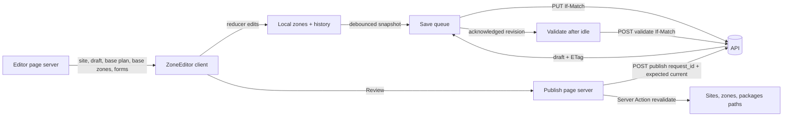

# Web UI plan: zone boundary editor and historical review

[Web handoff](ZONE-BOUNDARIES.md) · [Master plan](../docs/plan/zone-boundaries/README.md) · [Contract](../docs/plan/zone-boundaries/contract.md) · [Mobile UI plan](../mobile/ZONE-BOUNDARIES-UI.md) · Tasks WEB-28 to WEB-42 in [PLAN.md](PLAN.md)

Status: a plan; the web side is not built. Source inspection baseline: `33faa58` on 2026-10-11; contract aligned by CON-06.

BE-18 through BE-20 established draft, bound-upload and historical-read behavior under the previous implementation. Their evidence does not establish compliance with the rewritten contract. DB-19 supplies the current schema; BE-22 implements the sole `/v1` surface and regenerates OpenAPI and client declarations before dependent frontend integration.

**Pre-launch rule (2026-10-11):** there are no real users. Every archive uses the zone-aware manifest `format: 1`, every site starts at map version 1, and every observation references an immutable package and zone. Experimental incompatible data is reset rather than converted. Current-schema historical observations retain their recorded attribution.

Re-check fields against BE-22's generated types before wiring them. Every screen uses real API responses and server authorization; `zone_editing_available` is a display hint, not permission. Line references below describe the inspection baseline and can drift; re-read the cited function before editing it.

[web/ZONE-BOUNDARIES.md](ZONE-BOUNDARIES.md) holds the required behaviour. This file holds the interface design, state architecture, tasks and verification that satisfy it. The contract wins on wire semantics. Where it is insufficient, section 9 proposes changes for the lead. Do not build a divergent client.

## 1. Outcome

**Managers editing boundaries.** A manager opens a site and sees its current map version. They start or reopen a draft that the server saves as they work. They draw zones as shapes or rectangles, move, add and remove points, and rename zones. Undo and redo work. Problems show next to the zone, with what to do. Publishing goes through a review page that shows exactly what changes and what observers will experience, and it creates a new immutable version. A second manager's edit or publication never silently overwrites anyone's work. Polygons with holes and multi-part zones open, display and save without losing a coordinate.

**Managers and viewers reviewing data.** Every observation shows the zone label and map version it was recorded with. Filters, the table, the map and exports cover every matching observation, not the newest 500. They filter by a zone across versions, or by one exact version, and the page says which. An inventory reads as a whole-zone record, never a point. Nothing is reclassified against today's boundaries.

Never:

- Save session-only or fabricated state.
- Round, snap or repair a coordinate the manager did not move.
- Turn an unsupported shape into a rectangle.
- Last-writer-wins, auto-merge or auto-publish.
- Draw today's boundary under historical points and call it historical.
- Count or export a loaded page as "all matching".

## 2. What the code does today (verified)

| Area | Today | Evidence |
| --- | --- | --- |
| Maps | Pure React SVG. `SitePlan` is server-renderable; `MapFrame` adds zoom (0.5–8x the fitted frame), single-pointer pan when zoomed, arrow-key pan, an unused "armed" tap mode, and markers as the only interactive items. No map library; Leaflet was removed (D30). No pinch zoom, no zone hit-testing, no undo. | `src/components/map/MapFrame.tsx:71-80,238-336`, `SitePlan.tsx:425-676`, `web/package.json` |
| Projection | Equirectangular into a fitted 720×500 frame. `toPlan` and `fromPlan` are algebraic inverses with independent axes. Plan points are unrounded; only SVG strings round to 0.01 units. A round trip is bit-exact for real sites but not guaranteed (43% near 0°,0°). | `src/lib/plan.ts:98-152`; reader measurements on Fall Creek and random frames |
| Zone model | Keeps the outer ring only (holes dropped). The archive reader splits MultiPolygon zones into `id~n`, silently repairs or drops bad positions and rings, draws a missing zone as its bounding box, and ignores `zone_id`, `display_anchor` and `geometry_sha256`. | `src/lib/plan.ts:271-336`, `src/lib/sites/archive.ts:112-136,218-236,305-316` |
| Zone editing | The site page shows NotAvailable "Editing zones on the web". `/sites/:site/zones` and `/zones/*` redirect to the site page, and e2e asserts that the route is gone. A fixture-only editor was deleted in `4922f2b`; it rounded vertices to whole plan units (about 0.26 m at Fall Creek, ~176 m at a 1° site) and had undo but no redo. | `src/features/sites/SiteScreen.tsx:106-111`, `next.config.ts:29-30`, `e2e/removed-routes.spec.ts`, `git show 4922f2b^:web/src/features/sites/VertexHandles.tsx` |
| Server reads | `client.ts`: request-scoped `cache()`, bearer token, `no-store`, 15 s timeout. It returns data only (no headers) and casts responses to generated types. Only `/v1/me`, error envelopes and archive contents are zod-validated. | `src/lib/api/client.ts:30-91`, `identity.ts`, `errors.ts:39-47` |
| Writes | Server Actions (zod input, role re-check, one mutation, `revalidatePath` of the project layout). Body limit 2 MB. Packages and archives go browser-direct through `browser.ts`, with a refreshed Supabase token. The timeout signal replaces any caller signal, so callers cannot abort. | `src/features/sites/actions.ts:59-140`, `next.config.ts:40`, `src/lib/api/browser.ts:30-65` |
| CORS | BE-18 added `if-match` to `allow_headers`; `etag` is exposed. `if-none-match` and `Content-Disposition` are not. | `backend/src/fieldmaps_api/main.py:84-93` |
| Body limits | BE-18 sets 4 MiB for draft PUT (other zone paths keep 256 KiB), answers 413 `payload_too_large` on zone routes, and refuses encoded bodies. A maximal 20,000-position draft is about 0.78 MB of compact JSON. | `backend/src/fieldmaps_api/body_limits.py`; reader computation |
| Zone routes (BE-22 target) | Strong ETag headers and body `etag`, exact revision, current package/version, creator/updater IDs and display names. Lists include every manager's draft. Publication returns `{site_id, draft_id, package, current_package_id, replayed}`. Structural errors carry JSON Pointer paths; missing publication preconditions return 428. Zone request model names must not collide with form draft models. | [Contract: manager drafts](../docs/plan/zone-boundaries/contract.md#manager-drafts) |
| Package list (BE-22 target) | A site-UUID filter returns all immutable versions and the site's explicit current pointer. Package summaries carry version, exact forms, archive digest/size, zone count, change note, publisher and `source: upload \| draft`. First upload requires an explicit null current precondition and complete identity mapping. | [Contract: packages and reads](../docs/plan/zone-boundaries/contract.md#reads) |
| Draft storage (BE-22 target) | Save echoes geometry exactly, trims labels and lowercases UUIDs. Validation returns canonical digest and change classification against current. Publication revalidates, builds the immutable archive and commits it ready with snapshots and current pointer atomically. No rollout switch gates publication. | [Backend specification](../backend/ZONE-BOUNDARIES.md) |
| Error model | Was closed over 19 codes. The contract coordinator added the five new codes with copy, mapped to `rejected`, so they no longer retry as `unknown`. `details.issues` and conflict details are still dropped. | `src/lib/api/errors.ts:13-34,94-200` |
| Unsaved changes | `useLeaveGuard` covers beforeunload, same-origin anchors and popstate, but not `router.push` from the `g` shortcut chords or the command palette. The forms draft editor saves a snapshot and keeps later edits dirty, with no If-Match. | `src/features/shell/useLeaveGuard.ts:23-106`, `useShortcuts.ts:50-62`, `src/features/forms/DraftEditorScreen.tsx:143-179` |
| Data review | v1 list capped at 500. Site and round are filtered on the server. Zone, observer, day and search are filtered in the browser over the loaded rows. Labels come from current site zones. The zone filter is not scoped by site. Filters use `replaceState`, so Back does not undo them (despite the README). Every map is drawn on the current package. Inventory is drawn and exported as a point. CSV does not neutralise formula prefixes. | `src/features/data/view.ts:169-265`, `DataScreen.tsx:103-144,180-198`, `data/[observation]/page.tsx:37-64`, `src/lib/export/columns.ts:71-79` |
| Summaries | Overview coverage, Reports and every export are computed in the browser from the capped list and current zones. | `src/features/overview/CoverageSection.tsx:56-81`, `src/lib/observations/summary.ts:166-200` |
| Browsers in tests | Playwright uses the pinned Chromium only (`never playwright install`). Projects: desktop-1440 and phone-390 (touch) with axe; tablet-1024 and tablet-768 for honesty and screenshots only. No WebKit. | `web/playwright.config.ts` |

Prompt facts confirmed: MapFrame and SitePlan are SVG; zone editing is NotAvailable in `SiteScreen.tsx`; package import and history exist; reads are request-scoped and authenticated, with large package writes going browser-direct; `view.ts` filters only the loaded 500 and labels from current zones. Two docs are stale: `contracts/map-palettes.json:2` and `contracts/README.md:11` still say the web uses Leaflet.

## 3. Decisions

### WUI-1 Drawing surface: adapt the SVG plan; adopt no drawing library (confirm in the WEB-30 spike)

Build a dedicated editing layer on `MapFrame`/`SitePlan`. Use one pure geometry module (`src/lib/zones/`) that keeps GeoJSON longitude/latitude as the only source of truth. The plan projection is for drawing only: `fromPlan` runs only on vertices the manager moves or adds.

Evidence (the 2026-10-11 desk and scratch spike; packages installed only under `$TMPDIR`, nothing added to the repo):

- **Terra Draw 1.37:** its store, validator and render mode reject holes and MultiPolygon ("Feature has holes", "Feature is not Point, LineString or Polygon"), and a vertex drag rewrites ring 0 only. Its default `coordinatePrecision` of 9 rejected 2,000 of 2,000 full-precision server polygons; only precision 17 or more accepted all of them. Its decimal counter loops forever on a subnormal coordinate such as `1e-320`, which the backend range check accepts. It handles the primary pointer only and has no arrow-key or ARIA support. Contract zones are MultiPolygon after normalization, so Terra Draw is out.
- **OpenLayers 10.11:** Modify edits every ring and part. Geometry kept in EPSG:4326 (`useGeographic`) round-trips bitwise. A 3857 round trip changes values by up to 4.3e-14°, which would change `geometry_sha256`. About 97 KB gzipped for Map, View, Vector, Modify, Draw, Snap, Select and GeoJSON. No keyboard vertex editing and no undo.
- **mapbox-gl-draw 1.5.2 on MapLibre GL JS 6:** keeps rings and MultiPolygon. No undo, no keyboard, no type definitions. MapLibre adds about 285 KB plus a 144 KB worker gzipped, needs WebGL2 and needs worker-URL wiring under bundling. "MapLibre on the web" is on the post-pilot backlog ([docs/plan/README.md](../docs/plan/README.md)), so adopting it would be a lead decision.
- **Leaflet with Geoman:** reverses WEB-27, and Leaflet's `toGeoJSON` rounds to 6 decimal places by default.
- **No library** provides keyboard vertex selection and movement. Every canvas option would still need a DOM handle overlay synced to its camera, plus the `plan.ts`/`archive.ts` model fix that the read-only screens need anyway.
- **Edge snapping is never exact.** In 10,000 float interpolations, 0 points were exactly collinear (robust `orient2d`), so library edge snapping creates slivers the server rejects without tolerance. Only vertex-to-vertex snapping copying exact numbers is safe.
- **The SVG path:**
  - It has the children slot meant for "vertex handles" (`SitePlan.tsx:76`), the camera math, the armed mode, palette and chrome theming, marker accessibility patterns, and about 900 lines of deleted editor UX to reuse without its rounding.
  - `toPlan`/`fromPlan` changed 0 of about 163,000 numbers in the spike's round trip, but are not guaranteed exact near 0°,0° (errors up to 6e-18°). That is why longitude/latitude must stay the source of truth (WUI-2).
  - The geometry is small: at most 250 zones, 2,000 positions per zone and 20,000 per package (contract "Frozen input bounds").
- **Preview validators:** `@turf/boolean-valid` disagreed with 14 of 29 authored structure cases and passed the bow-tie. jsts matched every topology and relation case, but costs about 109 KB gzipped under EDL/EPL and was last released in 2024. Neither is adopted (WUI-5).

What would change this: the in-repo spike (WEB-30) fails its touch gate (real iPad Safari) or its performance gate (a 2,000-vertex drag). Then rerun every gate against OpenLayers 10.11 with `useGeographic`, Modify and vertex-only Snap, and a DOM handle overlay, on the same `src/lib/zones` model. The lead approves the dependency. Gates are in section 8.

### WUI-2 Geometry fidelity rules

1. The editor holds `{type, coordinates}` exactly as received from the draft. A Polygon stays a Polygon unless the manager adds a part.
2. Updates are immutable and structurally shared. An untouched position keeps the same `[lng, lat]` number pair, so `===` per number holds after any edit to another vertex.
3. A moved or added vertex takes `fromPlan(planPoint)` at full float64 precision, or a typed decimal value parsed exactly. Nudges move a fixed ground distance (WUI-8) using the selected vertex's own latitude.
4. A ring stays closed: moving vertex 0 also moves the closing position to the identical pair.
5. Never derive a coordinate from the DOM, an SVG string, a rounded label or `archive.ts` (which repairs geometry). Draft and snapshot geometry go through a strict reader that reports problems instead of fixing them.
6. Unchanged-draft test: load, save and reload a draft without edits, and every number must be identical. Run it on every contract fixture geometry.
7. The client computes no geometry digest and no canonical form. Normalization belongs to the server (contract). In BE-18, a save stores geometry as submitted, but trims labels and lowercases `zone_id` (`normalize_zone_draft_values`, `20261011121000_zone_drafts.sql:10-55`). The editor therefore sends trimmed labels and lowercase UUIDs (`crypto.randomUUID()` is lowercase), and compares after the same normalization. CR-W4 asks to freeze this.
8. A draft starts from its base package's canonical snapshots: MultiPolygons, rings rotated, ordered by code. Vertex addresses are fixed from the first load, and later saves keep them.

### WUI-3 Transport: browser-direct for draft operations

Draft GET (after the first render), PUT, validate, publish and DELETE go from the browser to the API through a new `src/lib/api/zones-browser.ts` built on `browserApi()`. Draft create, the draft list and historical reads run on the server.

Why: drafts may reach 4 MiB by contract; autosave runs every few seconds; the editor must abort superseded requests and read the ETag; and the repository already sends large package writes browser-direct. The browser could already read `etag` at HEAD but could not send `If-Match`. BE-18 fixed CORS (CR-W1) and the body limit (CR-W2); confirm both with a real browser preflight in WEB-35.

Fallback if the CORS change does not ship: Server Actions carry the PUT. A maximal compact draft (~0.8 MB) fits the 2 MB limit. Server Actions cannot be aborted and are serialized by Next.js; the save queue already allows only one write in flight, so it tolerates both. Build one transport, not both.

### WUI-4 Autosave with a single-flight compare-and-swap queue

The server draft is the only persistence. There is no browser storage of geometry: lab computers are shared, and autosave keeps the window of unsaved work to seconds. Unsaved edits live in memory and are guarded on leave (WUI-11). Section 6.3 gives the state machine.

### WUI-5 Validation: local structure always, server topology per revision

- Local structural checks run on every change and block saving. They cover closed rings, three distinct vertices, finite in-range numbers, the counts from `contracts/zones/geometry.cases.json` `limit_cases`, the label and code syntax, duplicate codes and the change-note length.
- Local topology hints are optional and never authoritative: ring self-intersection (a small in-house segment test) and vertices outside the site boundary. They are labelled "Found while editing". No geometry library: turf disagrees with the authored cases, and jsts's size and licence are not justified while the server validates.
- Server issues locate a zone, not a vertex. BE-18 sends paths like `/zones/3/geometry` and keeps only the first geometry issue per zone (`20261011121000_zone_drafts.sql:215-254`). The Problems list therefore points to the zone and fits it in view; local hints add the vertex when they find it. CR-W7 asks for an optional issue location.
- Server validation is sent only when no PUT is in flight and local equals acknowledged: after 10 s idle, from "Check boundaries", and on entering review. BE-18 limits validate to 30 per minute and publish to 10 per minute. A 412 on validate is never a conflict by itself: if a PUT is in flight or the acknowledged revision moved past the validated one, drop it and reschedule; otherwise GET the draft and follow the 412 path. A 429 waits for `Retry-After` and shows "Checking paused for 20 s". A result for an older revision is discarded.

### WUI-6 Publication is its own page

Publishing is a separate page, as forms do (`src/features/forms/PublishScreen.tsx`). The editor's strong action is ink "Review and publish". A drawing mode uses the accent frame (as armed placement does), so no screen carries two magentas (DESIGN rule 01).

### WUI-7 Conflicts are resolved by people

No merge, no rebase, no silent overwrite. Every conflict keeps the local geometry visible and offers explicit choices, including "Save my edits as a file" (a GeoJSON download the manager starts, so nothing depends on the tab staying open). Section 5.9 lists each case.

### WUI-8 Interaction defaults

- Arrow keys nudge a focused point 10 cm, and Shift+arrow 1 m. DESIGN §8 says "1 map unit / 10", which has no meaning in longitude/latitude. Propose the amendment to the design owner (section 9, CR-W17).
- The maximum editing zoom is set by ground resolution (1 cm per screen pixel), not 8x the fitted frame. Today a 0.1° site bottoms out at about 2.5 m per pixel.
- Snapping is on by default. It snaps to exact vertices of other draft zones and of the site boundary within 10 screen pixels, copying the exact number pair. Hold Alt (Option) to disable it while dragging. There is no edge snapping: a computed point on a segment is not exactly on it in float arithmetic, and the server rejects any positive-area overlap without tolerance (contract). Shared edges come from shared vertices and tracing (section 5.4). To start a shared edge partway along a neighbour's edge, first insert a point on the neighbour (an explicit edit, which shows that zone as changed), then snap to it.
- "Move shared points together" is on by default. Dragging a vertex also moves vertices in other draft zones with an identical coordinate pair. It is one undo step, and both zones show as changed.

### WUI-9 Review defaults

- Labels: the zone label recorded at collection, with the map version.
- Zone filters need one site (contract). Default matching is "any map version" of the stable zone identity, shown as "North meadow · all map versions". "One map version" narrows to package plus zone.
- Totals and summaries come from the server. Loaded pages are labelled as such.
- The Data map shows one map version at a time, with a version picker and dimmed points from other versions. It never shows today's boundary under historical points as if it were theirs.
- Inventory is listed and highlighted at zone level, never a marker.
- Exports are server exports for the same filter scope.

### WUI-10 State and caching: no new library

- Server components read: the site, draft, base package plan, historical zones and forms. They pass serializable props.
- The editor is one client root with a reducer (`state.ts`) and a save-queue hook. Selection, mode and history are local.
- No SWR or TanStack Query. Package-pinned zone snapshots are immutable, so the client may memoise them in a `Map` keyed `${userId}:${projectId}:${packageId}`. Current-pointer reads are never memoised.
- Autosave never calls `revalidatePath`. A layout revalidation re-downloads the archive and `/v1/me` (`actions.ts:59-61`, `workspace.ts:178-207`). Publish and discard call one Server Action that revalidates the site, zones and packages paths, then `router.refresh()`.

### WUI-11 Navigation guard covers every path out

Use `useLeaveGuard(dirty || saving || publishing)`. Add a shell `NavigationGuard` context that `useShortcuts` and `CommandPalette` consult before `router.push`. Editor keys never collide with the `g` chords, because single-letter editor keys are ignored while a `g` chord is pending. `?` lists the editor keys in the shortcuts dialog.

### WUI-12 Account fencing

- The editor root is keyed `${userId}:${projectId}:${draftId}`.
- Before every request, `zones-browser.ts` checks that the session's user equals the editor's `userId`.
- A Supabase `onAuthStateChange` to a different user stops the queue and replaces the editor with "You are signed in as someone else. This draft belongs to the previous account." It purges local state and the per-package memo. Unsaved edits since the last autosave are lost in this case by design: they must not be shown to another account.

### WUI-13 Route

Reuse the glossary word. The `/sites/:site/zones` redirects come out of `next.config.ts` in the same change that adds the pages (WEB-37), and `e2e/removed-routes.spec.ts` and `SCAN_ROUTES` are updated with it:

| Route | Who | What |
| --- | --- | --- |
| `…/sites/[site]/zones` | Managers and viewers | Current version, version history, and `?version=1` read-only view; managers also see drafts and "Start a draft" |
| `…/sites/[site]/zones/drafts/[draft]` | Managers | Editor |
| `…/sites/[site]/zones/drafts/[draft]/publish` | Managers | Review and publish |

`[site]` stays the site code in URLs. The site list supplies the UUID for API paths (contract: never infer UUID versus code).

## 4. Entry points and site states

The site page's zone island and the Zones page derive one state from the site (`current_package_id`, `zone_editing_available`) and the role:

| State | Managers see | Viewers see |
| --- | --- | --- |
| No ready package | "No map package yet" ScreenState with "Upload package" | "No map package yet" |
| `zone_editing_available` false (no usable site boundary or published form) | Cause-neutral until CR-W12 adds a reason: "Editing zones on the web is not available for this site yet." + "Edit the zones layer in QGIS and upload a new package." Reason-specific wording only from `zone_editing_unavailable_reason` | Version history only |
| Site with a map package | "Edit zones" and "Zone versions", current version line "Map v1 · published Oct 10 by JL" | "Zone versions" and the current version line |

Observers never reach these pages: the project layout already sends them to collect.

## 5. Manager editing

### 5.1 Zones page (`…/sites/[site]/zones`)

- **Header:** "Zones · Riverside", eyebrow "MAP v1", and actions for managers: ink "Start a draft from v1", or "Open your draft" when the manager has one.
- **Current version island:** the plan with zones (lossless, WEB-31), a zone table (label, code in mono, parts and holes, area when available) and facts (published at and by, change note, how it was made: "Drawn on the web" or "Imported from QGIS"; CR-W11).
- **Open drafts** (managers): one row per draft with "Based on v1", last edited by and at, and revision. A stale draft (base is not current) reads "Based on v1 · v2 is current", with Open, Save as file and Discard.
- **Versions:** v2 Active, v1 Archived ("Replaced by v2"), with change note, date and author, and a link to `?version=1` (read-only plan and zone table). Mark "current" from `current_package_id`, never newest-ready (`history.ts:31-34` today).
- **Restore an earlier version:** "Restore v1 boundaries in a new draft" on every archived version. A draft must be based on the current package to publish (contract.md:72; `services/zone_publication.py:122-139` refuses a stale base with 409). So the action creates a draft from `current_package_id`, then PUTs the zones from `GET /zones?package_id=<v1>` (same `zone_id`, code, label and geometry; zones added after v1 show as removed). It opens the review page, which diffs against current and prefills the change note "Restores v1 boundaries".

Amended 2026-10-13 (WEB-37), as built:
- **Header line:** "Map v2 · published Oct 11, 2026 · drawn on the web". The publisher is not named: a package carries only the publisher's identity, and the member list that would name them is for managers only.
- **Actions:** a manager with an open draft on the current version gets ink "Open your draft" beside outline "Start another draft"; otherwise ink "Start a draft from v2".
- **Zone table:** name, code, and parts and holes. Areas come with the review page (WEB-38), from the check of a revision.
- **Open drafts:** each row has Open and "Save as file". Discard comes with WEB-38.
- **Restoring an earlier version** opens the new draft in the editor until the review page exists (WEB-38 moves it there). The draft's change note starts as "Restores v1 boundaries". A replayed start is not restored a second time.
- **`?version=` with a version the site does not have** shows the current version with a note.
- **Who sees what:** viewers see the versions and none of the draft parts, and nothing about drafts is read for them. The site page's Zones island links "Edit zones" (managers, where editing is available) or "Zone versions". The "Editing zones on the web" note stays only where editing is not available.

### 5.2 Starting a draft

- A Server Action calls `POST zone-drafts {request_id, base_package_id}`. The request ID is generated when the dialog opens, so a double click or a retry replays. On success, navigate to the editor.
- **Another open draft on the same base:** "JL has a draft based on v1, edited 11:32. Both can be edited, but only the first one published becomes v2. Open JL's draft / Start my own draft."

### 5.3 Editor layout (`…/zones/drafts/[draft]`)

**Desktop (1024 px and wider):** a PageHeader with breadcrumbs (Sites › Riverside › Zones › Draft) and the title "Edit zones · Riverside". The meta line is the save status (5.8). Actions: ink "Review and publish", and outline "Discard draft" (danger confirm). Below the header, two columns.

- **Map island (left):** a toolbar row, then MapFrame.
  - Toolbar: `Segmented` tools (Select · Draw shape · Draw rectangle), IconButtons (Undo, Redo, Fit zone, Remove point), and switches (Snap to points, Move shared points together).
  - Canvas: base package background (ground, paths, trees). All draft zones are dashed, with faint fill and labels. The selected zone is hatched with focus dashes, and the others are dimmed (DESIGN §9). The selected ring shows vertex and midpoint handles. Problem zones carry a numbered ink pill.
  - Overlay label: "Riverside · Day plan / Draft from v1", or the mode instructions.
  - Scale chip: "0–25 m · Map v1 draft · north ↑".
- **Panel (right):**
  1. **Zones** island: roving rows (label, code, "New", "Changed" or "Unchanged" in words, problem count) and outline "Add a zone".
  2. **Selected zone** island:
     - Label field (1–200 characters, trimmed).
     - Code field: editable only for a zone new in this draft. An existing code is locked with the visible reason "Codes never change. A new code makes a new zone."
     - Identity line: "Same zone as in v1" or "New zone in this draft".
     - Shape facts: "1 part · 1 hole · 214 points".
     - Actions: Remove hole n, Remove part n, Remove zone. Removing a zone reads "Removes North meadow from the next version. Earlier versions and their observations keep it."
  3. **Points** island (the text equivalent of the map, DESIGN §9): a ring picker ("Part 1 · outer edge", "Part 1 · hole 1"), then a table with "Point 12", longitude and latitude in mono shown to 7 decimals, editable at full precision, and actions Insert after and Remove. Paginated 100 at a time, with "214 points · decimal degrees". The selected row follows the selected handle.
  4. **Problems** island: "Checked revision 6 at 11:33 · 2 problems · 1 warning". Each problem reads what, where, what to do, with "Show on map". Warnings are separate.

**Under 1024 px:** the map stacks over the panel. The toolbar wraps, and tools keep 44 px targets.

### 5.4 Tools

| Tool | Pointer and touch | Keyboard | Result |
| --- | --- | --- | --- |
| Select (default) | Tap or click a zone to select it. Drag empty map to pan when zoomed. Pinch to zoom. | `V`. Zones rows with arrows, j/k and Enter. | Selection only |
| Move point | Drag a handle. | Focus a handle (Tab enters the selected ring at the selected point), arrows 10 cm, Shift+arrows 1 m, `[` and `]` previous and next point, Home and End | One history step per drag or per burst of nudges within 1 s |
| Insert point | Drag or click a midpoint handle (shown when the edge is at least 24 px long on screen). | `I` inserts after the focused point, at the edge midpoint | Exact midpoint in plan space through `fromPlan`; neighbours untouched |
| Remove point | Remove point button, or Delete. | Delete or Backspace | Refused below three distinct vertices, with the reason announced |
| Draw shape | Click to add points; click the first point, double-click or press Enter to finish; Esc cancels; Backspace removes the last point. | `P`. A centre cross appears; arrows move the cross (5.5); Space adds a point at the cross; Enter finishes | New zone with a client UUID, a suggested unused code and an empty label to fill in. Unfinished shapes stay local (contract) |
| Draw rectangle | Drag. | `R`. Space sets the first corner at the cross, Space again the opposite corner | Four corners aligned to longitude and latitude (the plan axes are independent) |
| Trace an edge | While drawing, two consecutive points snapped to the same ring offer "Follow the edge of Slide" (`T`, press again for the other direction). | Same | Copies the exact intermediate vertices, so zones share edges without slivers |
| Remove hole or part | Selected zone island | Same buttons | Zone keeps its identity |

Built in WEB-33 and WEB-34 (2026-10-12), beyond the rows above: while drawing, the toolbar offers Finish shape, Remove last point, Follow the edge and Cancel drawing, so touch needs no keyboard; Ctrl+Z (⌘Z) takes back the last drawn point before it undoes earlier steps; a rectangle can also be set by two clicks; a finished drawing selects the new zone and moves focus to its Name field; Escape with no points leaves the drawing tool. Redo is a word button until CR-W17 adds `redo-2` to both icon registries.

Deferred: drawing a hole, adding a part, split and merge tools. Holes and parts are always displayed, preserved and editable point by point. To split or merge, remove a zone and draw new ones; the Zones page explains that this makes new identities (master plan, "Identity, labels and boundary edits").

### 5.5 Map interaction contract

- `MapFrame` gains a mode (`pan`, `edit` or `draw`), a camera context (`usePlanCamera()`: camera, pixels per plan unit, `clientToLngLat`), and key ownership: a focused child marked `data-map-keys` consumes arrows, Delete and Escape, so the frame does not pan (today it pans for any descendant, `MapFrame.tsx:258-295`).
- Fix `frameUnits` to measure the SVG box, or use `getScreenCTM().inverse()`, so it is not off by the 1–2 px border (`MapFrame.tsx:219-224`).
- Two-pointer pinch and pan in `edit` and `draw` modes, with `touch-action: none` on the canvas. Drags are batched per animation frame.
- The selected ring is one tab stop (roving tabindex): only the current handle has `tabIndex=0`. `[`/`]`, Home and End move focus within the ring. Tab and Shift+Tab leave the canvas, and Esc returns focus from a handle to the zone's row in the Zones list. Reuse the deleted editor's names and announcements, not its per-vertex tab stops.
- In draw mode the arrow keys move the centre cross itself (10 cm, Shift 1 m, position announced). The camera follows only when the cross nears the frame edge, and the pan clamp is lifted in `edit` and `draw` modes, so keyboard drawing reaches every site-boundary vertex at any zoom.
- The editor's map has a working height on every screen (`min(72svh, 42rem)`, at least 22rem). At its plain proportions a 390 px phone showed a plan about 300 × 210 px, most of it under the label and the controls.
- Handles are map chrome, not map data: island fill with an ink ring, scoped with `mapChromeTheme(palette)` like marker focus rings. They have a 44 px hit area, `role="button"`, the name "Point 12 of 214, North meadow, outer edge", and `aria-pressed` for the selected one. Above about 300 visible points, draw non-interactive dots and say "Zoom in to edit points, or use the points table."
- The static background is memoised separately from the editable layer, so a drag re-renders only the selected ring. Replace `Math.min(...spread)` in `plan.ts:130-135,217-223` and `archive.ts:349-352` with loops; they throw at about 125,000 arguments (measured).
- Problems are marked on the canvas only with palette means and chrome: hatch, heavier dashes, a numbered ink pill. The attention colour and words live in the Problems island (rule 03).

### 5.6 Undo and redo

- History holds semantic steps: move or nudge points (including shared moves), insert, remove point, add zone, remove zone, remove hole or part, label change (merged per field focus) and code change (new zones). It keeps at most 200 steps.
- ⌘Z or Ctrl+Z undoes; ⇧⌘Z, Ctrl+Shift+Z or Ctrl+Y redoes. Both are ignored while typing, where the field keeps its own undo. Undo and Redo buttons carry their reason when there is nothing to undo.
- History survives autosaves; undoing after a save is saved as a new revision. It is cleared by reloading after a conflict, by discarding and by an account change.
- Announce each step politely: "Undid: moved point 12 of North meadow."

### 5.7 Leaving and discarding

- Leaving with unsaved changes or a save in flight opens the "Save your changes first?" dialog (reuse `DraftEditorScreen.tsx:388-414`): Keep editing, Leave without saving, or Save and leave (waits for the queue).
- "Discard draft" opens a Dialog: "Discard this draft? Its boundaries are not published and nothing else changes. Published versions and observations are not affected." Then danger-solid "Discard draft". It sends DELETE with If-Match, then revalidates and returns to the Zones page.

### 5.8 Save status (Island meta and live region; not state words)

| Situation | Text | Live announcement |
| --- | --- | --- |
| Acknowledged, no local changes | "Saved to the draft · 11:32 · revision 6" | — |
| Local changes waiting | "Unsaved changes" | — |
| Request in flight | "Saving…" | — |
| Local structure invalid | "Not saved yet · North meadow needs a name." | polite |
| Unconfirmed (network, timeout, 5xx) | "Checking whether your last change was saved…", then the outcome | polite |
| Offline | "You are offline. Your changes stay in this tab and save when you reconnect. Do not close the tab." | polite |
| Conflict | "Not saved · someone else saved this draft at 11:40" with the conflict dialog | assertive |
| Signed out | "Not saved · you were signed out. Sign in again in another tab, then come back to save." | assertive |

Save feedback stays out of `StateBadge`: the state vocabulary has no saving or conflict words, and DESIGN forbids inventing them (section 9, CR-W16 asks the designer). "Unsaved changes" already ships this way (`features/org/settings/SettingsScreen.tsx:136`).

### 5.9 Failure and conflict handling

| Response | Editor result | Choices |
| --- | --- | --- |
| 412 `revision_conflict` on PUT | Stop the queue and keep local. GET the draft to show who saved and when, and a map overlay of their version (dashed) under yours | "Replace the saved draft with my edits" (explicit PUT with the new ETag, after confirmation), "Discard my edits and load the saved draft", "Save my edits as a file" |
| 409 `conflict` (draft published or discarded elsewhere) | Read-only with the outcome: "This draft was published as v2 by JL at 11:41" or "discarded" | "Open v2", "Start a draft from v2", "Save my edits as a file" |
| 428 `precondition_required` | A client defect. Stop, report the request ID, and reload the draft metadata while preserving edits | Same as 412 |
| 413 or `too_complex` | "Not saved · this draft is larger than DECA Mark accepts (20,000 points per site, 2,000 per zone, 250 zones)." Point to the largest zone | Edit, or save as file |
| 422 structural issues | Map issues to zones by `zone_ids`, falling back to `path` | Fix and continue |
| 401 | Status "signed out" (5.8). Keep the queue paused until the token refreshes | Sign in in another tab |
| 403 or 404 | "You no longer have access to this draft." Keep local in memory | Save my edits as a file |
| Network, timeout or 5xx | Treat as unconfirmed. GET the draft: if `revision == sent + 1` and the zones deep-equal the sent snapshot, acknowledge; if the revision is unchanged, retry; otherwise treat as a conflict | Automatic |
| 429 on validate or publish | Wait for `Retry-After`; "Checking paused for 20 s" or "Publishing paused for 20 s. Nothing was published." | Automatic retry for validate; explicit retry for publish (same `request_id`) |
| Any 409 on publish | First GET the draft. If `state == published`: "This draft was already published as v{n}." with "Open v{n}" (from `published_package_id`). If discarded: the discarded outcome. Only if still a draft, the row below | — |
| 409 `publication_conflict` on publish | "Not published. v2 was published while you were reviewing. Your draft is based on v1 and is unchanged." | "Start a draft from v2" (this draft stays readable as a reference), "Save this draft as a file" |

### 5.10 Review and publish (`…/publish`)

- **Header:** "Publish zones · Riverside", eyebrow "MAP v1 → NEXT VERSION". Use the server's current version to say "Publishing creates the next version after v1. v1 never changes." A proposed next number is provisional until the publication succeeds.
- **Readiness for revision n:** blocking problems link back to the editor; warnings (site gap, small zone) are listed; "Ready to publish" only when `ready` is true for this exact revision.
- **Changes:** use required validation `zones[].change` and `geometry_sha256` at the acknowledged revision, classified against the current package. Raw coordinate-array differences are not authoritative: equivalent geometry can use different ring order or type spelling. If the current pointer changed, show the conflict and prevent publication until the manager creates a draft from current.
- **Map:** base boundaries dashed and validated geometry changes hatched, labelled "Hatched: boundary changed since v1" when base is current (DESIGN §9). A stale draft's base overlay is labelled as its base and never presented as the current comparison.
- **What observers experience:** "Observers keep v1 for observations they have started and for anything not yet uploaded. They get the new version once they download it in the DECA Mark app, and use it from their next collection after that. Until then they can keep collecting on v1, and those observations keep v1."
- **Forms:** play form version, and inventory form or "No inventory on this map".
- **Change note:** a Textarea of up to 2,000 characters, recommended but optional. It is part of the draft, so editing it saves a revision.
- **Confirm:** a checkbox "I understand published boundaries cannot be edited. Changes need a new version." It enables primary "Publish new version" ("Publish v2" when the next version is known).

Submitting:

- Generate `request_id` when the page opens for revision n, and keep it in `sessionStorage` under `zone-publish:${draftId}:${revision}` so a reload reuses it. Send `{request_id, expected_current_package_id}` with If-Match.
- 201: show the result, revalidate, and open the Zones page with a Toast "v2 is published. Observers use it after they download it in the DECA Mark app." (no celebration).
- 200 replay: if the result package is not the current one (CR-W9), say "This draft was already published as v2. v3 is current now." Never claim it is current.
- Unconfirmed: "DECA Mark could not confirm whether this was published. Nothing is lost." Then automatically GET the draft. If its state is published, show that result. Otherwise offer "Try again", which reuses the same `request_id`.
- 422 issues: return to the problems list. 412: reload the draft and validate again.

Amended 2026-10-13 (WEB-38), as built:
- **Map:** the draft's zones are drawn over the base version's background, and zones whose boundary changed, or that are new, are hatched ("Hatched: a boundary changed since v1, or a new zone."). The base boundaries are not drawn under them; that overlay waits for the WEB-28 acceptance pass, with the 412 one.
- **Readiness and changes:** the check runs half a second after the review opens, and again after each saved change to the note. Readiness and the changes list (DECA Mark's `zones[].change`, changed zones first) are for that revision only.
- **Publish and its answers:**
  - The button reads "Publish v3" (current + 1). It is enabled only for a saved, checked, ready revision of a draft based on the current version, with the box ticked.
  - A 201 opens the Zones page with the toast.
  - A 200 replay shows its result on the page.
  - No answer, or a 5xx, reads the draft. If it is published, the same request is sent again (same ID, same revision's ETag), which returns the first answer. Otherwise it offers Try again with that same request.
  - Any 409 reads the draft first: published as above, discarded as its outcome, and otherwise the publication conflict copy with "Start a draft from v2" and "Save this draft as a file".
  - A 412 reads and checks the draft again.
  - A 429 says "Publishing paused for 20 s. Nothing was published."
- **Discard:** offered in the editor, on the review page and on each row of the Zones page's drafts list. It sends DELETE with the draft's ETag, then `zonesChangedAction` revalidates the site's paths.
- **The editor's "Review and publish"** saves first and then opens the review. A restored version opens straight on its review page, with the note "Restores v1 boundaries".
- **Fixed on the way:** the editor read its draft again whenever the page re-rendered with new props, which could have replaced edits not yet saved. It now reads the draft once per editor.

### 5.11 Uploading a QGIS package

Every package upload goes through the same activation rules as publishing (contract "QGIS upload"). Missing, duplicate or unused identity mappings return 422 `validation_failed` with an `identity_conflict` issue. Missing `expected_current_package_id` returns 428; the first upload must explicitly send null. `UploadStep` gains a mapping step. On a site's first upload there are no current zones, so every feature becomes a new zone and the step only asks for codes where the source ID does not fit.

1. After "Read project" and the layer checks, list each source zones-layer feature by its `properties.id` and name.
2. For each feature, the manager picks "Same zone as …" (the current version's zones, by label and code) or "New zone".
   - A feature that carries a `zone_id` property matching a current identity is preselected, because the file supplies the known UUID.
   - A feature whose code or label merely matches is shown as a suggestion and left unselected. Labels and codes do not prove continuity (master plan).
   - A new zone gets a client UUID and uses the source ID as its code when it fits the code syntax; otherwise the manager types a code.
3. Current zones that no feature maps to are listed: "Removed from the next version: Swings. Earlier versions and their observations keep it."
4. A change note is recommended ("What changed", at most 2,000 characters).
5. The inventory form is chosen with the play form (amended 2026-10-13: `inventory_form_version` is part of `PackageRequest`): "Keep the current one · <code>" leaves the field out so the current map's form carries over; "None: no Inventory on this map" sends null; or a published form. A site's first upload starts on the most recently published form that asks only about a zone, or on None when there is none.
6. Zone names (amended 2026-10-13): BE-22 reads a zone's label from the feature's `name`, while the QGIS templates write `label`. The zones layer is sent with `name` filled from `label` when `name` is missing, nothing else changed, and the mapping step says "Names come from each zone's name field, or its label field when it has none." A zone with neither blocks the upload ("Zones have a name").
7. Submit with `request_id`, `expected_current_package_id`, `zone_identity_map` and `change_note`. While an answer is unknown (no response, or a 5xx), the attempt is kept whole: "Upload package again" resends the same body, so a request that did arrive replays. A changed request after that is still sent against the same `expected_current_package_id` and current zones, so it is refused rather than applied to a map published by the first.
8. Results:
   - 409 `publication_conflict`: "Not uploaded. Map v2 was published meanwhile. Read the current version and choose each zone again." The upload conflict carries only `current_package_id`, so without a version it reads "The site's current map changed meanwhile."
   - 422 with `details.issues`: each issue's copy (6.7) names the feature by its `properties.id`, through the issue's `/zone_identity_map/N` path or its zone IDs.
   - 503 `storage_unavailable`: "Not uploaded. The map could not be saved. Your files stay chosen. Try again."
   - Success: show the returned package version, Active only when the response's `current_package_id` is that package; a replay says "The same package had already arrived, so no new version was made."

### 5.12 Screen states for the new routes

| State | Zones page | Editor | Publish page |
| --- | --- | --- | --- |
| Loading | Still rows after 400 ms, "Loading zone versions…" | Still panel rows plus the base plan, "Loading the draft…" (also while the mount GET runs) | "Checking this draft…" |
| Read failure | `LoadFailure` | `LoadFailure` | `LoadFailure` |
| Empty | "No open drafts." / no package: "No zone versions yet. Upload a package from QGIS to create v1." | — | — |
| Draft not found or discarded | — | "This draft is no longer open. Published versions are not affected." + ink "Return to zones" | Same |
| Draft already published | — | Read-only, "Published as v2 by JL at 11:41." + "Open v2" | Same outcome |
| Offline | `waitingSoft` banner "You are offline. Showing what loaded at 11:36." | `waitingSoft` banner "You are offline. Your changes stay in this tab and save when you reconnect. Do not close the tab."; Review and Discard disabled with that reason | Banner; Publish disabled with the reason |
| No access | No-access state (managers only for drafts) | No-access state before any read | No-access state before any read |

## 6. Architecture

### 6.1 Module map

New files, owned by the web agent:

| Path | Purpose |
| --- | --- |
| `src/lib/zones/geometry.ts` | Types, strict reader, vertex addressing `{zoneId, part, ring, index}`, closed-ring maintenance, immutable edits, nudge in metres, rectangle, midpoint, structural checks with limits, equality |
| `src/lib/zones/hints.ts` | Snapping (exact vertex index with a grid bucket over at most 20,000 positions), tracing between two vertices of one ring, ring self-intersection, vertex outside site |
| `src/lib/zones/schemas.ts` | zod runtime schemas for ZoneDraft, ZoneDraftSummary, Validation, Publication, HistoricalZones, Site, PackageSummary, issues and conflict details. Provisional until BE-22 OpenAPI, then `satisfies z.ZodType<components[…]>` (the `identity.ts` pattern) |
| `src/lib/zones/copy.ts` | Issue code to manager copy (6.7) |
| `src/lib/api/zones-browser.ts` | Draft GET/PUT/validate/publish/DELETE returning `{data, etag}`. The caller's signal is combined with the timeout through `AbortSignal.any` (add the same option to `browserApi`). Includes the user check (WUI-12) |
| `src/features/zones/` | `ZonesPage.tsx`, `StartDraft.tsx`, `editor/{ZoneEditor,state,history,save-queue,EditorCanvas,Handles,DrawLayer,Toolbar,ZoneList,ZoneProperties,PointsTable,Problems,SaveStatus,ConflictDialog}.tsx/ts`, `publish/{PublishReview,diff}.ts(x)`, `history/VersionList.tsx` |
| `src/features/shell/NavigationGuard.tsx` | Guard context for programmatic navigation |
| `src/features/data/observations.ts`, `query.ts` | Observation page, summary and export adapters; URL ↔ server filter builder |

Changed files:

- `src/components/map/MapFrame.tsx` (mode, camera context, key ownership, pinch, `frameUnits`, zoom by ground resolution).
- `src/components/map/SitePlan.tsx` (zones with parts and rings, `zone_id` keys, memoised background). Amended 2026-10-13: outer edges are drawn winding one way and holes the other under a `nonzero` fill, so holes stay unfilled and overlapping parts (`multipart_overlap`, a valid draft) stay filled; `pointInParts` counts windings the same way, so what is drawn is what is hit. Zone outlines keep the decimals the zoom needs to stay within 0.05 px of their handles.
- `src/lib/plan.ts`, `src/lib/sites/archive.ts` (lossless zones; strict reader; no bounding-box stand-in).
- `src/lib/api/{errors,workspace,browser,types}.ts`, `src/lib/time.ts` (project day to UTC instant).
- `src/features/{sites,packages,data,observation,overview,reports,qgis}/*`, `src/lib/export/*`.
- `next.config.ts`, `e2e/support/routes.ts`, `e2e/removed-routes.spec.ts`.

Shared files that need a coordinator: `contracts/contour.json`, DESIGN.md and both icon registries (designer), and `contracts/openapi.json` and both `schema.d.ts` files (contract coordinator; never hand-edit).

### 6.2 Data flow

### 6.3 Save queue

State: `acknowledged {revision, etag, zones, changeNote, updatedAt, updatedBy}`, `local`, `inFlight {seq, snapshot} | null`, `status`, `pausedReason`.

1. A change schedules a save 1.5 s after the last edit. During continuous editing, it waits at most 10 s. A drag commits only on pointer up. Blur, `visibilitychange` to hidden, and "Save and leave" flush immediately.
2. Skip the save when `local` deep-equals `acknowledged` or local structure is invalid. In the second case, show the reason.
3. Only one PUT is in flight. Changes made meanwhile set "dirty after flight".
4. Success: `acknowledged = sent snapshot` (assert that the returned zones deep-equal it; on a mismatch, keep local and log the request ID). Adopt the ETag. If local differs from it, send again.
5. Failures follow 5.9. A pause holds until the manager acts or the token refreshes.
6. Each response carries its sequence number. A response that does not match the current flight is ignored, so a late response can never roll local state back.

On mount (including after Back from the review page, when the router restores old server props), the editor GETs the draft browser-direct before accepting edits or scheduling a save. If the server revision is newer than the props, it adopts the server draft (zones, note, ETag). If `state != draft`, it opens read-only with the 409 outcome. The first If-Match never comes from props alone. Until that GET returns, the editor shows its loading state.

The queue is a pure reducer (`save-queue.ts`) plus a thin effect hook, so every branch is a unit test.

### 6.4 Runtime validation and errors

- Every new response passes its zod schema before use. A failure is treated like an unknown response: no state change, retry, and the request ID shown.
- The contract coordinator already mapped the five new codes to `rejected` with generic copy. WEB-35 refines this:
  - `revision_conflict`, `precondition_required`, `publication_conflict` and `idempotency_conflict` get a `conflict` kind that the editor handles per 5.9;
  - `payload_too_large` gets a size kind;
  - `details.issues` and the conflict details are kept in `ApiError` and in a serializable form for Server Action results.

Amended 2026-10-13 (WEB-35), as built:
- **Error kinds:** `ErrorKind` keeps its three kinds. The editor reads each failure's status, code, issues, `Retry-After` and `X-Request-Id` through `queueFailure` (`features/zones/editor/failure.ts`); conflict and size are the queue's pauses. `ApiError` now keeps `requestId`. A session that ended before a request was sent counts as signed out, never as a lost answer.
- **Transport:** browser-direct as WUI-3 planned, confirmed by a real Chromium preflight with `If-Match` against the local API. `browserApi` takes the caller's signal (combined with the timeout through `AbortSignal.any`) and `expectUser`: a request is refused before sending when another account is signed in.
- **The 412 dialog** names the zones that differ ("Zones that differ: North meadow and Slide") in place of a map overlay of the saved draft. The overlay waits for the WEB-28 acceptance pass. Its choices are as 5.9, with "Decide later", which leaves a "Not saved" note with "Choose what to keep".
- **A 409 (published or discarded elsewhere)** replaces the editor with the outcome, "Open the site" and "Save my edits as a file". "Open v2" and "Start a draft from v2" come with the Zones page (WEB-37).
- **Header and checks:** "Review and publish" and "Discard draft" come with WEB-38. "Check boundaries" sits in the Problems island. A check also runs after 10 s without changes, and its line reads "Checked revision 6 at 11:33 · 2 problems · 1 warning". When the draft has changed since, it adds "the draft has changed since, so it is checked again once saved".
- **Leaving and shell navigation:** WUI-11's guard is a small module (`features/shell/navigationGuard.ts`) rather than a context. `useLeaveGuard` holds shell navigation while it is on, and `useShortcuts` and the command palette go through `guardedPush`. The pending `g` chord lives in `lib/shortcuts.ts`, so the editor leaves the chord's second key alone. "Save and leave" keeps the guard on until the save lands, then leaves.
- **Saving a drag:** a drag reports its zones once, when it ends, so a save never carries a point mid-drag.
- **Routes:** only the `zones/:path*` redirect is gone. Unknown paths under `zones/` are not-found pages. `…/zones` still redirects to the site until WEB-37.

### 6.5 Capability, not flags

Editing appears only when `zone_editing_available` is true for this manager on this site, and the server re-checks every write. There are no client feature flags and no environment toggles. Before BE-18 the pages show the NotAvailable state from section 4.

### 6.6 What can be built before the API exists

WEB-30 to WEB-34 need no API. Unit tests use the contract fixture geometries. A dev-only `/dev/zone-editor` specimen (dev and preview builds only, like `/dev/contour`) exercises the canvas with in-memory geometry from `contracts/zones/geometry.cases.json`. It has no save, publish or network code, and its overlay reads "Specimen shapes · nothing is saved". Wiring (WEB-35 onwards) waits for BE-18 and the regenerated types. Nothing returns invented success responses.

### 6.7 Issue copy (manager language; "polygon" is avoided)

Web copy must also pass the honesty scan's banned words (`e2e/support/scan.ts`): never "session", "server", "UUID", "JSON", "API", "preview" or "sample" on a workspace route. "Start collecting" replaces "session" in manager copy about observers.

| Code | Text (what, where, what to do) |
| --- | --- |
| `self_intersection` | "North meadow's edge crosses itself near point 12. Move a point so the edge no longer crosses." |
| `invalid_topology` | "North meadow's shape is not valid: a hole or part overlaps another. Check its holes and parts." |
| `zero_area` | "North meadow has no area. Move its points apart." |
| `outside_site` | "Part of North meadow is outside the site boundary. Move it inside, or trace the site edge." |
| `interior_overlap` | "North meadow and Slide overlap. Zones may share an edge but not area. Move the shared edge so they only touch." |
| `duplicate_code` / `duplicate_zone_id` | "Two zones use code NM. Give one a different code." |
| `identity_conflict` | "Zone NM's identity belongs to another site or code. Remove it and draw it as a new zone." |
| `unsupported_extent` | "This site is too large or crosses the date line or a pole. DECA Mark supports sites up to 1° across." |
| `too_complex` | "Too many points: at most 2,000 per zone and 20,000 per site." |
| `empty_zone_set` | "Add at least one zone before publishing." |
| `form_not_in_package` | "The inventory form cannot change in a zone edit. Keep the form this map uses." |
| `site_gap` (warning) | "About 120 m² of the site is in no zone. Observers cannot place points there." |
| `small_zone` (warning) | "Slide is smaller than 1 m². Check that it is meant to be this small." |

## 7. Manager review (WEB-29)

### 7.1 Data page

- **Server load:** parse the URL, resolve `site` (code) to `site_id` through the site list, convert project-timezone days to half-open UTC instants (new `time.ts` helper, DST-tested), call `GET /v1/…/observations?limit=500`, and parse it.
- **More pages:** a Server Action `loadObservations({query, cursor})` returns the next page. The cursor stays in memory, never in the URL. Rows are de-duplicated by ID. Changing a filter resets to the first page.
- **Counts:**
  - "Showing 1–500 of 1,284 matching observations · counted at 11:32", from `total_matching` and `generated_at`.
  - "Show the next 500".
  - "Refresh" re-runs the query from the first page.
  - Remove every "Based on the newest 500 observations" note this replaces.
- **Columns:** Observation, Observed, Site, Zone (label at capture, with the code in mono under it), Map (`v1`), Round, Observer, Answer.
  - Inventory rows: Zone shows "Whole zone".
- **Search:** there is no server text search, so the box reads "Search loaded observations" and its count says "12 of 1,284 loaded match" (contract: "search this page").

### 7.2 Filters and URL

| Control | URL | API |
| --- | --- | --- |
| Site | `site=<code>` | `site_id` |
| Zone (needs a site; disabled with the reason "Choose a site to filter by zone" otherwise) | `zone=<uuid>` (repeatable) | `zone_id` (OR) |
| Zone match: "All map versions" or "One map version" | `version=7` when one | adds `package_id` |
| Round | `round=standard` | `round_type` |
| Observer (exact) | `observer=AB` | `observer` |
| Days in the project timezone | `from=2026-10-01&to=2026-10-07` | `observed_from`, `observed_before` (start of `to + 1`) |

- **Zone options:** the union of summary groups for the scope (without the zone filter) and the current package's zones. Each option shows its label history and versions ("North meadow · v1–v2", "Swings · v1 · not in the current map"). CR-W13 proposes an identity catalogue endpoint so options can include zones with no records yet.
- **History:** discrete filter changes push a history entry, so Back undoes them, as the README promises. Search typing replaces the entry, debounced 300 ms.

### 7.3 Data map

- **Version choice:** with one site chosen, the map draws one version. Default order: the filter's version if one is set; otherwise the current version if any result uses it; otherwise the newest version in the results.
- **Version picker:** "Boundaries: v2 (current) ▾" lists the versions present, with counts from the summary.
- **Points from other versions:** dimmed, with the note "Points recorded on v1 are dimmed. Their zones may differ from these boundaries."
- **Geometry:** recorded package geometry through `getSitePlan(packageId)`, plus `/zones?package_id`, memoised per package. Zones keep their holes and parts (WEB-31).
- **Inventory:** never a marker. Show a "Zone inventories in this view" list under the map (zone, version, count). Selecting an inventory row hatches its zone, switching the picker to its version.
- **Subset note:** "The map shows the 500 loaded of 1,284 matching observations." Totals come from the summary.
- **Amended 2026-10-13 (WEB-40):**
  - The geometry is the version's own package archive only. The archive carries that version's zones with their `zone_id`, code and name, so `/zones?package_id` is not read for the plan; QGIS still reads it for the boundaries download.
  - The picker shows only when the matches span more than one version; the island's meta names the drawn version, with "(current)" when it is.
  - The counts come from the summary of the same filters (the zone filter included). If it cannot be read, the versions and inventories are counted from the loaded observations, and the picker hint and the inventories footnote say so.
  - Other versions' plans are read through a Server Action that checks the package belongs to the site, then memoised per `${userId}:${projectId}:${packageId}` (WUI-10), at most 8 per tab. If one fails, the plan keeps the version it shows and says so, with Try again.
  - The inventories are a flush island under the plan, "Zone inventories in this view": a table with one tab stop (zone, map, inventories). Choosing a row hatches its zone and switches the plan to its version. A whole-zone record selected in the table is hatched too when its version is drawn.

### 7.4 Record detail

| Record | Map | Facts |
| --- | --- | --- |
| Bound point | Recorded package (`package_id`) with its zone hatched. "Map v1, the version this observation was recorded with." plus "v2 is current." when it differs | Zone "North meadow (NM) · map v1" |
| Bound inventory | Recorded zone hatched, no point. "An inventory of the whole zone. No point was recorded." | Same |
| Historical map cannot load | "We could not load map v1 for this observation. The record and its zone are unchanged." with Try again | Facts unaffected |

Amended 2026-10-13 (WEB-40): a package that loads but cannot be drawn as a plan says "Map v1 of Fall Creek cannot be drawn as a plan. The record and its zone are unchanged.", without Try again, because trying again reads the same archive. "v2 is current." comes from the site list. If that read fails, the line is left out and the page still loads.

### 7.5 Overview, Reports and the site page

- **Coverage:** from `GET /v1/…/observations/summary?site_id=…`. Rows are recorded snapshots: the current version's zones first (zero rows from the current package zones), then "Recorded on earlier versions" (`v1 · North meadow`). Columns are the round types. Keep "Coverage is the records present, not completion."
- **Field return:** the total from the summary; today and the last 7 days from the summary with date bounds.
- **Panels with no server dimension** (observer, day, play type, last received): keep them, but compute them from the newest 500 with the existing note, until CR-W15 adds facets. Never mix exact and page-limited numbers without saying which is which.
- **Reports:** zone and round from the summary. Observer and day follow the rule above. Amended 2026-10-13 (WEB-41): days are filters DECA Mark applies (they were applied in the browser to the newest 500), so every bar covers the same scope; when more match than the newest page holds, the sentence leaves out observers and days, and the observer, day and play type sections are titled "…, newest observations" under a note naming both counts.
- **Site page zone island:** counts "recorded on v2" from the summary filtered to the current package, plus "N on earlier versions".

### 7.6 Exports

- **Data export dialog:**
  - "Export 1,284 matching observations" as CSV or GeoJSON downloads the server ZIP. It is fetched browser-direct with the bearer token (`GET /v1/…/observations/export?format=csv|geojson`, the same filters, no cursor or limit).
  - The ZIP holds `observations.csv` or `observations.geojson`, `codebook.csv`, `metadata.json`, `forms.json` and `historical-zones.geojson` (`routers/observation_analysis.py:46-70`). The browser names it `<site-or-project>-observations-<yyyy-mm-dd>.zip`.
  - The dialog repeats the scope: filters, match basis, local days with their UTC bounds and the timezone.
- **Limits:** 10,000 rows, 32 MiB and 10 s per export (`domain/observation_export.py:21-24`).
  - When `total_matching` exceeds 10,000, disable Export with the visible reason "One export holds up to 10,000 observations. Narrow the dates or choose one site."
  - A 422 `validation_failed` whose issue code is `export_scope_too_large` gets the same text, without counts until CR-W15.
- **Codebook and formula protection:** the server writes the codebook and protects every CSV cell. The client builds neither. Any remaining client CSV (none planned) must neutralise `=`, `+`, `-`, `@`, tab and CR in text cells.
- **Client exports (amended 2026-10-13, WEB-41):** the browser-built CSV, GeoJSON and codebook are removed; Data and QGIS both download the server ZIP. The Data dialog's button reads "Export 1,284 matching observations", lists the scope one filter per line (zones say "every map version, by the zone's identity" or "only what was recorded on map v2"; days give the UTC bounds), and says when the page's search is not applied to the file.
- **QGIS page:** "Records out" uses the same server export. "Maps for QGIS in" adds, per site, "Download zone boundaries of v1 (.geojson)" built from `/zones?package_id` (UUID, code, label and version properties). Exports already carry `historical-zones.geojson` for their own scope.

## 8. Tasks and order

Status lives in [PLAN.md](PLAN.md). WEB-28 and WEB-29 remain the acceptance gates; the new tasks below do the work. No task exceeds L (3–5 days); split any that does.

| Task | Size | Depends | Builds | Done when |
| --- | --- | --- | --- | --- |
| WEB-30 | M | CON-05 | In-repo spike of Option A against the nine gates; OpenLayers only if gate 4 or 8 fails | Gate results recorded below; harness deleted |
| WEB-31 | M | CON-05 | Lossless zone model in `plan.ts`, `archive.ts` and `SitePlan`: parts, holes, `zone_id`, strict reader with no box stand-in, loops instead of spreads, memoised background | Fixture round trips are number-identical; holes render; every existing map screen passes its tests |
| WEB-32 | L | WEB-31 | Pure editor core: geometry ops, history, structural checks from `limit_cases`, snapping, tracing, hints, save-queue reducer | Unit tests cover every operation and save-queue branch; `structure_cases` agree |
| WEB-33 | L | WEB-30, WEB-32 | Canvas: MapFrame modes, camera context, key ownership, pinch, handles, select/move/insert/remove, Zones list, selected zone, Points table, keyboard map, dev specimen | Keyboard-only and touch-emulated editing of every fixture shape, holes preserved |
| WEB-34 | M | WEB-33 | Drawing: shape, rectangle, keyboard drawing at the cross, snap feedback, tracing, remove hole or part | Two adjacent zones drawn with a traced shared edge show no overlap issue at server validation (verified in WEB-28) |
| WEB-35 | L | BE-22, WEB-33, DB-18 | Persistence: schemas, `zones-browser.ts`, error kinds, autosave queue wiring, save status, conflict dialog, validate and Problems, navigation guard, account fence; the manager-gated editor route and removal of only the `zones/:path*` redirect | Unit tests with contract-shaped responses; local stack PUT/validate round trip |
| WEB-36 | M | BE-22 | Single site API and explicit current pointer across Sites, site page, package history copy, QGIS page and plan selection; `siteId` in views; package history queries use the site UUID | Every version appears in history; the explicit pointer alone identifies current |
| WEB-42 | M | BE-22, WEB-36, DB-18 | QGIS upload with zone identity mapping: identity mapping step, removed-zone list, change note, request ID retry, conflict and identity errors (5.11) | A first upload creates v1; a later upload with a mapped, a new and a removed zone creates v2 |
| WEB-37 | L | WEB-35, WEB-36 | Zones page, Start draft, drafts list, version history, read-only versions and restore, site page entry, removal of the root `zones` redirect | e2e: viewer sees history, manager starts and reopens drafts, observer and viewer are refused editor URLs |
| WEB-38 | L | WEB-35, WEB-37 | Review and publish: changes, base versus new map, observer effect, change note, confirm, request ID retry, replay, publication conflict, revalidation, discard | e2e publish, replay and conflict pass on the local stack |
| WEB-39 | L | BE-22, WEB-36 | Observation list: adapter, filters, URL history, pagination, totals, columns, inventory rows, search labelling | Above-500 fixture: table counts and paging agree with the summary |
| WEB-40 | M | WEB-39, WEB-31 | Historical maps: version picker, dimming, inventory list, subset note, record detail on the recorded package, memo keys | Mixed-version fixture never draws current boundaries as historical |
| WEB-41 | L | WEB-39 | Summaries and exports: coverage, field return, reports, site counts, the server ZIP export with scope text and the 10,000 ceiling, QGIS zones download | `observations.csv` in the ZIP has exactly `total_matching` rows; above 10,000 the action is disabled |
| WEB-28 | L | BE-22, WEB-34, WEB-38, WEB-42 | Acceptance for editing and QGIS uploads | Section 10 editing evidence |
| WEB-29 | L | BE-22, WEB-40, WEB-41 | Acceptance for review | Section 10 review evidence |

Parallel work (explicit file ownership, no reverting others): WEB-30 to WEB-34 are one agent's lane in `src/lib/zones/`, `src/features/zones/editor/` and `src/components/map/`. WEB-36 and WEB-39 to WEB-41 can be a second lane in `src/features/{data,observation,overview,reports,qgis,sites,packages}/`, `src/lib/export/` and `src/lib/time.ts`. The two lanes share `src/components/map/*` and `src/lib/plan.ts`: WEB-31 lands first, and later map changes go through the editor lane. Integration gate after each task: `pnpm web:check`, `pnpm --dir web test:unit`, and the e2e specs it touches.

### WEB-30 spike gates

The desk spike settled the library question (WUI-1). WEB-30 proves Option A in the repository on the dev-only `/dev/zone-editor` specimen (6.6; gated like `/dev/contour`: development, and preview builds made with `NEXT_PUBLIC_PREVIEW_TOOLS=1`), built on the pure model with `node:test` tests and the lossless rendering of rings and parts. *Amended 2026-10-12:* there is no separate throwaway harness to delete. The spike's harness is the specimen WEB-33 keeps, because gates 4 and 8 still need a real iPad and are run on it; it has no save, publish or network code and no production route. Results are recorded below.

- **Fixtures:**
  - from `contracts/zones/geometry.cases.json`: square, holed, multipart, concave, reversed, duplicate_vertex, bow_tie, outside_hole, collinear, multipart_overlap, multipart_shared_edge;
  - synthetic full-precision variants (15–17 significant digits, plus one coordinate needing more than 20 decimals);
  - a 2,000-position zone and a 250-zone, 20,000-position site (`limit_cases`);
  - one real ready package from the local stack (Fall Creek upload sample). *Amended 2026-10-12:* until BE-22 ships the contract archive and DB-18 seeds the stack, the specimen uses the Fall Creek upload layers themselves (`qgis/fall-creek/upload-sample/`: the site boundary, trees and Zone A at full precision), the input that package is prepared from.
- **Gates:**
  1. **Lossless.** Load then serialise with no edit gives identical JSON. After one pointer move and one keyboard move, every other position is `JSON.stringify`-equal at its address, ring and part counts are unchanged, and the closing position equals the first.
  2. **Shapes.** Holes render unfilled. Hole and part vertices can be selected and moved. Nothing collapses to a box. Removing below four positions in a ring is refused.
  3. **Keyboard.** Tab onto a vertex; arrows and Shift+arrows move it, Delete removes it, Escape cancels, and ⌘/Ctrl+Z and ⇧⌘/Ctrl+⇧+Z undo and redo. MapFrame does not pan while a handle has focus. Announcements go through a live region. Axe reports no violations.
  4. **Touch, real iPad Safari** (Chromium `hasTouch` emulation does not count): vertex drag without page scroll or zoom, pinch zoom, 44 px targets, no long-press callout.
  5. **Palette.** Day and Night come from `contracts/map-palettes.json` with no hard-coded colours. Handles have at least 3:1 contrast in both palettes.
  6. **No tiles.** The request log shows no tile or glyph requests.
  7. **Bundle.** The editor route adds at most 60 KB gzipped of its own code and nothing to other routes. *Clarified 2026-10-12:* "nothing" means no editor module (`src/features/zones/**`) in another route's chunks. The shared map changes this plan requires on every plan (WEB-31's lossless zones, 5.5's `MapFrame` modes) are measured and reported, not counted as editor code.
  8. **Performance.** A 2,000-vertex drag holds at least 50 fps on an iPad, and the 20,000-position site renders in under 200 ms.
  9. **Hints.** The local hints flag bow_tie and outside_hole, and do not flag holed, multipart, duplicate_vertex or reversed. Collinear and overlap cases are left to the server.
- **Failure rule:** if gate 4 or 8 fails, rerun gates 1–9 against OpenLayers (`useGeographic`, Modify, vertex-only Snap, DOM handle overlay) before choosing.

#### Results (2026-10-12)

Measured on the working tree of 2026-10-12 with Node 24.21, Next.js 16.2.7 and the pinned Chromium 1194. Browser checks are `e2e/specimen/zone-editor.specimen.ts` (`pnpm --dir web test:specimen`, desktop-1440 and phone-390 with touch emulation, no local stack); unit checks are `tests/unit/zone-*.test.mjs`. No dependency was added; OpenLayers was not needed.

| Gate | Result | Evidence |
| --- | --- | --- |
| 1 Lossless | Pass | Every valid `structure_cases` shape re-serialises byte-identical; one move leaves every other position the same array at its address (unit). In both browsers all 15 specimen sets serialise unchanged; keyboard, mouse and touch moves change only the moved point, its closing twin and points shared with it; part and ring counts hold and every ring stays closed. |
| 2 Shapes | Pass | A hit test in the middle of a hole finds no zone (holes wound against their outer edge, nonzero fill), and one where two parts overlap finds it; multipart and holed zones draw one subpath per ring; the concave zone keeps all six points. Hole and second-part points are selected from the Edge picker and moved by keyboard. Removal below three different points is refused and announced. |
| 3 Keyboard | Pass | Tab reaches the ring's one tab stop and the next Tab leaves the ring; arrows move 10 cm and Shift+arrows 1 m; `[`, `]`, Home, End, Delete and `I` work; Escape returns to the Zones list; Ctrl+Z and Ctrl+Shift+Z undo and redo to the exact loaded numbers, on every fixture set. The frame's camera transform does not change while a handle has focus. Every step is announced in a polite live region. Axe: no violations with a point selected, in the Day and Night palettes, and in the Day and Dusk themes (honesty scan). |
| 4 Touch, real iPad | **Pending (user)** | Chromium touch emulation (does not count): a touch drag on every fixture set edits only that point, the plan does not move under the finger, two-finger pinch zooms, handle targets are 44 px. Found and fixed on the way: a touch's implicit capture made drags end at once, and at 390 px the label and controls covered most of the plan (the editor's map now has a working height). Found in review (2026-10-13) and fixed: a second finger during a point drag or a rectangle drag turned into another drag instead of a pinch (the frame now counts every finger before the layers see it, and a pinch drops the layer's gesture: the point goes back, no corner is set); drawing threw over plain HTTP on a LAN address, where `crypto.randomUUID` does not exist (new zones now take their identity from `src/lib/ids.ts`). Both have specimen or unit tests. |
| 5 Palette | Pass | No hex, `rgb()` or `hsl()` in the editor or map code (unit). The handle ring is the chrome theme's ink: at least 3:1 on every surface of both palettes (computed from both contracts) and as rendered in Day and Night. |
| 6 No tiles | Pass | While editing and zooming, every request is to the page's own host; none is a tile, glyph or basemap. |
| 7 Bundle | Pass | `/dev/zone-editor` loads 39.7 KB gzipped that no other route loads (the specimen shapes included); no editor module appears in any other route's chunks. Against a build of the committed baseline, the eight routes that draw a plan grew 2.2–3.4 KB gzipped (WEB-31's strict zone reader and parts, and `MapFrame`'s edit and draw modes); other routes moved by under 0.5 KB in either direction (chunk splitting). |
| 8 Performance, iPad | **Pending (user)** | Desktop Chromium on a production build (does not count): the 250-zone, 20,000-position site is drawn 53–66 ms after it is chosen (three runs); a 2,000-point drag holds a 16.7 ms median frame (60 fps) with a 16.7–16.8 ms 95th percentile. Under `next dev` the same draw takes about 200–870 ms, so measure on a production build. Found and fixed: the label search took 556 ms for 250 zones; a centre well inside its zone is now used as it is (4 ms). |
| 9 Hints | Pass | Unit and browser: `bow_tie` (crosses itself near point 3) and `outside_hole` are flagged; `holed`, `multipart`, `duplicate_vertex`, `reversed`, `concave`, `collinear`, `multipart_overlap` and `multipart_shared_edge` are not. Coverage agrees with all 16 `coverage_cases` and containment with all 3. |

Gates 4 and 8 on a real iPad (local network only; the specimen has no data and makes no network calls). `pnpm --dir web dev --hostname 0.0.0.0` does not work for this: verified on 2026-10-12, Next.js 16 refuses its development connection from any host but `localhost` unless `allowedDevOrigins` lists it, and the page never becomes interactive. A production build works from the network address and gives representative timings:

1. On a computer on the same Wi-Fi as the iPad, from the repository root: `pnpm --dir web install`, then `NEXT_PUBLIC_PREVIEW_TOOLS=1 pnpm --dir web build`, then `NEXT_PUBLIC_PREVIEW_TOOLS=1 pnpm --dir web start --hostname 0.0.0.0`.
2. Find the computer's address (macOS: `ipconfig getifaddr en0`) and open `http://<address>:3000/dev/zone-editor?shapes=fall-creek` in iPad Safari, in portrait and in landscape.
3. Gate 4: select Zone A, press Fit zone, drag a point with a finger (the page must not scroll or zoom, and a long press must show no callout), pinch to zoom in and out, and check each point's target takes a fingertip easily. Start a point drag and put a second finger down: the plan pinches and the point goes back. Repeat on "Holed square" for a hole point. Then choose Draw rectangle, start a drag and put a second finger down: the plan pinches and nothing is drawn; tap out a shape with Draw shape to check drawing works over plain HTTP.
4. Gate 8: choose "250 zones · 20,000 points" from Shapes and read "Drawn in … ms" beside the note (under 200 passes). Choose "2,000 points", select the zone, drag its point 1 for a few seconds, and read "Last drag: … frames a second" (at least 50 passes).
5. Record the iPad model, iPadOS and Safari versions, the numbers and screenshots in this table. A failure opens a new task and follows the failure rule.

## 9. Contract and backend change requests (send to the lead)

Each request is precise and additive unless marked. "Accept" is the acceptance case. Status as of the 2026-10-11 single-path contract. "Done" means verify it in the consuming task. "In contract (BE-22)" means the rewritten contract adopted it and BE-22 implements it.

| ID | Status | Change | Reason | Affects | Accept |
| --- | --- | --- | --- | --- | --- |
| CR-W1 | Done (BE-18) | `if-match` in CORS `allow_headers`, with preflight tests for PUT, POST and DELETE | Browser-direct conditional writes failed preflight at HEAD | Web editor | PUT preflight with `authorization, content-type, if-match` returns 200 |
| CR-W2 | Done (BE-18) | 4 MiB limit for draft PUT; 413 `payload_too_large` on zone routes | HEAD's 256 KiB admitted about 6,700 positions | Web editor | 4,194,304 bytes accepted, one more refused |
| CR-W3 | In contract (BE-22) | Declare the `ETag` response header on get, PUT and DELETE (only create 201 declares it); optionally add `etag` to the draft body; rename the zone `DraftCreate`, `DraftReplace` and `DraftPublish` to `ZoneDraft*` so the forms `DraftCreate` keeps its generated name | Generated types should carry the header; the collision already renamed both components | Web types | Types carry the header; `components["schemas"]["DraftCreate"]` is the forms model again |
| CR-W4 | In contract (BE-22) | State, with a test, that draft GET and PUT return zones exactly as submitted (Polygon stays Polygon, no ring rotation); normalized geometry only in validation or publication | Vertex addressing, undo and the unchanged-draft test break if a save rewrites geometry; contract.md says "return the canonical geometry" without saying when | Web editor | A Polygon with an odd ring start comes back with equal JSON values |
| CR-W5 | Partly done (BE-18) | Folded into the single-path contract; BE-22 publishes every response model | Clients otherwise write schemas from prose | Web and mobile | Generated types exist before WEB-39 starts |
| CR-W6 | In contract (BE-22) | New codes, 412 and 428, issue translation with JSON Pointer paths, and 428 for a missing `expected_current_package_id` exist. Add a typed conflict-details schema (`draft_id`, `revision`, `etag`, `current_package_id`) to OpenAPI | Clients branch on details | Web and mobile | The conflict details are typed in schema.d.ts |
| CR-W7 | In contract (BE-22) | Validation adds per-zone `geometry_sha256` and `change: added \| removed \| geometry_changed \| label_changed \| unchanged` against current. Issue-location geometry remains an unapproved extension | Truthful review diff without recomputing canonical forms | Web review | Changes match an authored fixture |
| CR-W8 | In contract (BE-22) | Drafts carry `forms`, current/base package versions, timestamps, creator/updater IDs and display names (inherited admins included). Compute the proposed next version from current and label it provisional; no `next_package_version` wire field is promised | Honest version and author copy | Web editor and publish | Fields present; changed current yields 409 at publish |
| CR-W9 | In contract (BE-22) | Publication responses and replays include `current_package_id` and `replayed` | An old replay must not read as current; wrappers lose the 200/201 distinction | Web publish | Old replay after a newer publish returns `replayed: true` and the newer current ID |
| CR-W10 | In contract (BE-22) | The draft list already returns every draft on the site. Add author names, and state in the contract that there is no presence or locking and that 412/409 are the only concurrency signals | The entry flow offers "Open JL's draft" | Web Zones page | Second manager sees the first's draft with a name |
| CR-W11 | In contract (BE-22) | PackageSummary carries `site_id`, `package_version`, exact forms, digest/size, `zone_count`, `change_note`, `published_by` and `source: upload \| draft`; the list carries `current_package_id`. Additional publisher display names and draft-operation identifiers are not promised | Version history must use authoritative fields | Web history, mobile CR-M1 | History renders from the list alone |
| CR-W12 | Open | Propose `zone_editing_unavailable_reason` (`not_manager`, `no_site_boundary`, `no_eligible_form`) for specific copy. Current contract promises the boolean and UUID site detail only | Specific unavailable-site copy | Web site page, mobile | Lead approves the extension before a client depends on it |
| CR-W13 | Open | Add `GET …/sites/{site_id}/zone-identities` → `[{zone_id, zone_code, versions:[{package_id, package_version, zone_label}]}]` ; let historical `/zones` accept repeated `package_id` with immutable caching headers for pinned packages | Filter choices with retired zones; mixed-version maps without N requests | Web filters and maps | Retired zone appears with its versions |
| CR-W14 | Closed | A draft must be based on the current package to publish (contract.md:72, `zone_publication.py:122-139`). Restore works through a new draft from current (5.1) | — | Web Zones page | — |
| CR-W15 | Open (BE-20) | The list item is now frozen in the contract. Still open: add optional summary facets (observer, project-day, form_version) and `latest_received_at`; give `export_scope_too_large` details `{matching_rows, limit_rows}`; a terminal scope record in exports; expose `Content-Disposition`; `export?layer=zones` for GeoJSON; export metadata echoes the timezone and UTC bounds | Table, reports and exports need them; page-limited panels otherwise remain | Web review | Each field or facet is in OpenAPI and used once |
| CR-W16 | Open (designer) | Add a `boundary` state kind (draft, published, discarded) to `contracts/contour.json`, or approve label overrides of form states; confirm save feedback stays as meta text | DESIGN forbids inventing state words; the code already relabels | Both apps | `pnpm tokens:check` passes; both galleries show the states |
| CR-W18 | Closed | The publication switch is deleted (contract "What the rewrite removed") | — | — | — |
| CR-W19 | In progress | Compatibility deletion is now CON-06, DB-19 and BE-22 | — | All | — |
| CR-W17 | Open (designer) | Amend DESIGN §8's zone editor rules to "Arrow 10 cm, Shift+arrow 1 m"; add Redo (⇧⌘Z), the points table unit "decimal degrees", tool icons (`redo-2`, `pen-tool`, `square-dashed`) in both registries; mark the section built when WEB-28 ships; record a decision superseding D30's "zone editor not available"; correct the Leaflet mentions in `contracts/map-palettes.json` and `contracts/README.md`; reconcile DESIGN §9's collector hatch rule with the shipped spotlight and halo (`mobile/src/features/collect/CollectMap.tsx:592-614`); replace the `preview` wording in DESIGN's overlay example, which the web honesty scan bans | DESIGN, PRODUCT, `web/README.md` and D30 all say the editor is not built | Docs, both apps | Docs agree with the shipped editor |

## 10. Verification and done evidence

### Automated (local only, never hosted research data)

- `pnpm web:check`, `pnpm --dir web build`, `pnpm --dir web test:unit`, `pnpm tokens:check` and `pnpm plan:check`.
- Unit tests (`tests/unit/*.test.mjs`):
  - geometry ops and fidelity on every fixture geometry (unchanged-draft test);
  - structure cases;
  - history steps and merging;
  - every save-queue transition (success, dirty-after-flight, late response, 412, 409, 428, 413, 422, 401, 403, unconfirmed-then-acknowledged, unconfirmed-then-conflict, offline);
  - snapping and tracing exactness;
  - the diff fallback;
  - URL ↔ query mapping, including old `?zone=<code>` links;
  - project day to UTC across both DST changes in America/New_York;
  - summary-to-coverage adapter;
  - CSV formula neutralisation;
  - zod schemas against contract-shaped examples.
- Local stack (DB-18 after DB-19/BE-22): an opt-in seed that uses only the real local API. The seed creates map versions 1 and 2, a site with no package, two managers' open drafts, and more than 500 observations across both versions, including Inventory. No hosted mutations are part of acceptance.
- e2e on the local stack (`sh scripts/e2e-local.sh`), real API, desktop-1440 and phone-390:
  1. `zones-editor.spec.ts`: manager starts a draft, draws a rectangle and a shape, edits points by keyboard and by touch emulation, sees a topology problem, fixes it, reloads (state persisted), then publishes.
  2. `zones-conflict.spec.ts`: two browser contexts as two managers. Both save on the same revision: one wins, the other gets the conflict dialog with its edits intact. Two publications from one base: one activates, the other gets 409. Two tabs of one manager publish the same revision with different request IDs: the second shows "already published as v2". Editor → review → Back → edit saves without a conflict.
  3. `zones-publish.spec.ts`: lost response simulated by aborting the request after send; retry with the same request ID returns the original package. Replay after a newer publication shows it is not current.
  4. `zones-access.spec.ts`: viewer and observer open editor and publish URLs directly and see no access; viewer sees history.
  5. `zones-network.spec.ts`: offline mid-edit, then reconnect, saves; navigation with unsaved changes asks first, including `g` chords and the command palette.
  6. `data-history.spec.ts`: seeded above 500 observations across v1 and v2. Totals, paging, zone filter by identity and by version, map version picker, inventory list, record detail on v1.
  7. `export.spec.ts`: unzip; `observations.csv` data rows equal `metadata.json`'s total; `codebook.csv` and `historical-zones.geojson` are present; a formula-leading label is protected; above 10,000 the action is disabled with its reason.
  8. Honesty and axe scans include every new route in Day and Dusk: no serious or critical axe findings, one primary action, no banned words.

### Manual (recorded with commit, browser and screenshots)

- **Keyboard only:** full edit, publish and review without a mouse. Screen reader (VoiceOver with Safari, NVDA with Firefox or Chrome): handle names, announcements and dialogs.
- **iPad Safari** (real device, against the local stack on the LAN, never hosted data): drag, pinch, draw, the 44 px handles, and the leave guard.
- **Browser matrix:** Chrome and Firefox on desktop at 1440 and 1024; Safari macOS at 1440; iPad Safari at 1024×768 portrait and landscape. Reduced motion on: camera moves jump.
- **Performance:** the WEB-30 measurements, repeated on the final build.

Done means WEB-28 and WEB-29 evidence exists for each item above. Compilation, mocked tests or a single browser do not count. Missing manual evidence is recorded as pending, not passed.

## 11. Open questions for the lead

1. WUI-3: confirm browser-direct draft writes now that BE-18 allows `if-match` cross-origin. The alternative is the Server Action transport.
3. WUI-8: snapping and "move shared points together" on by default?
4. WUI-1: if the spike favours a library, who approves the dependency and the change to the "MapLibre on the web" post-pilot backlog?
5. Product defaults the editor enforces: no interior overlap (adjacent edges allowed), a site boundary required, and edits only over an existing imported package. Confirm, or revise CON-05 first.
6. CR-W16 and CR-W17: designer approval for the state kind, the nudge distances, the icons and the decision row that supersedes D30.
